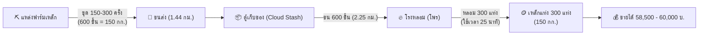
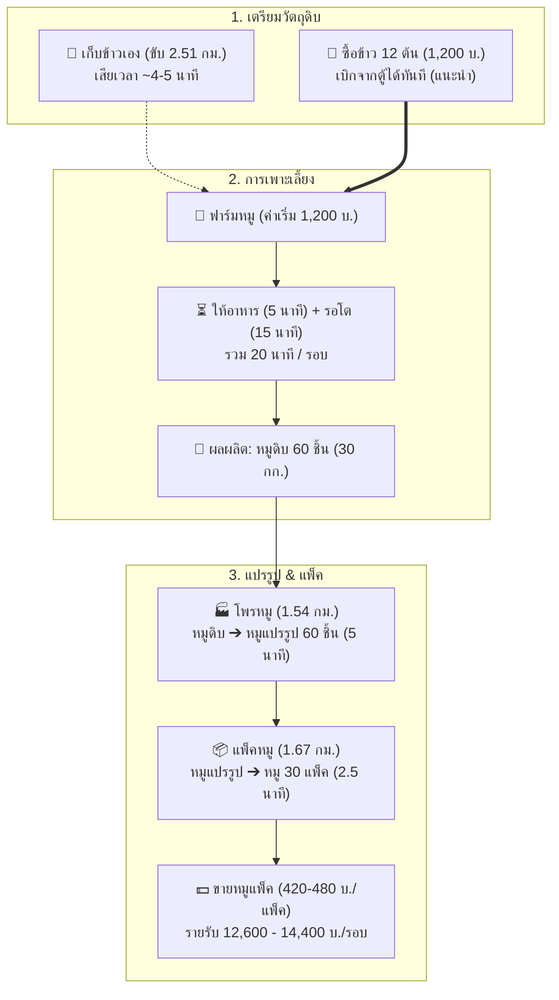
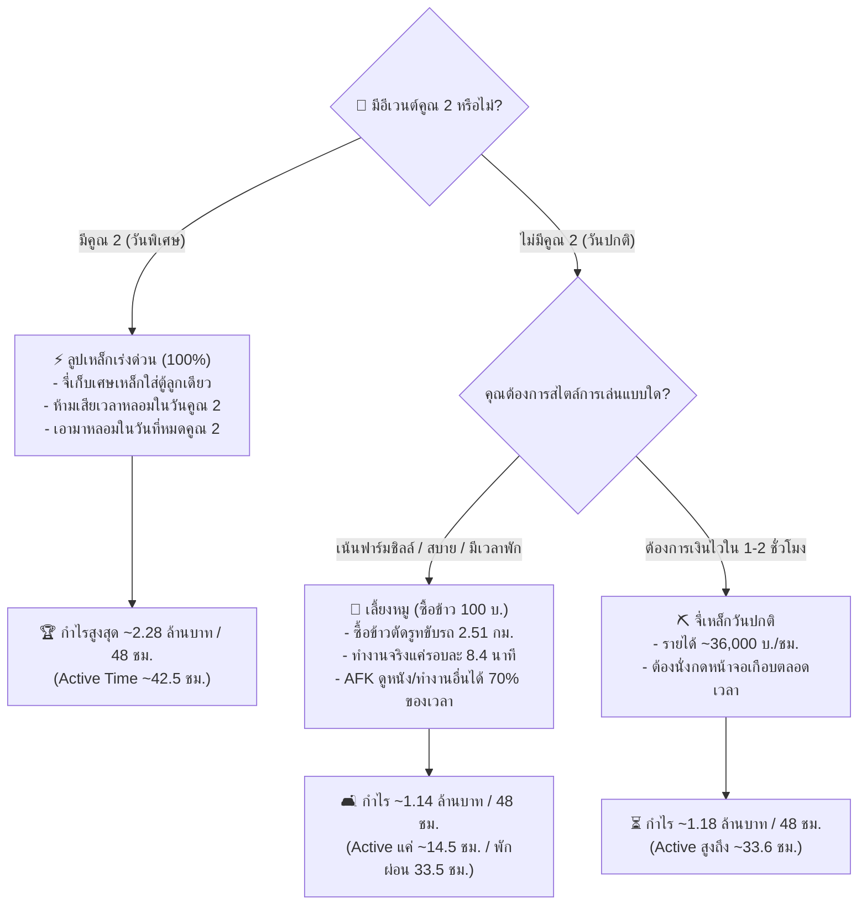

# 📊 คู่มือวิเคราะห์โมเดลเศรษฐกิจ & รูทฟาร์ม (เหล็ก vs หมู)
> เอกสารสรุปการคำนวณต้นทุน, เวลา, รูทขนส่ง, ความจุกระเป๋ารถ, และการเปรียบเทียบกำไรสุทธิ 48 ชม.

---

## 📌 สารบัญ
1. [ข้อมูลพื้นฐาน & กลไกของทั้ง 2 อาชีพ](#1-ข้อมูลพื้นฐาน--กลไกของทั้ง-2-อาชีพ)
2. [ข้อมูลระยะทาง & รูทการเดินทาง (Logistics)](#2-ข้อมูลระยะทาง--รูทการเดินทาง-logistics)
3. [ความจุกระเป๋ารถ (150 กิโลกรัม) & The Perfect Ratio](#3-ความจุกระเป๋ารถ-150-กิโลกรัม--the-perfect-ratio)
4. [วิเคราะห์โมเดลเหล็ก (วันปกติ vs วันคูณ 2)](#4-วิเคราะห์โมเดลเหล็ก-วันปกติ-vs-วันคูณ-2)
5. [วิเคราะห์โมเดลหมู (เก็บข้าวเอง vs ซื้อข้าว 100 บาท)](#5-วิเคราะห์โมเดลหมู-เก็บข้าวเอง-vs-ซื้อข้าว-100-บาท)
6. [การเปรียบเทียบมาราธอน 48 ชั่วโมง](#6-การเปรียบเทียบมาราธอน-48-ชั่วโมง)
7. [สรุปคำแนะนำเชิงกลยุทธ์ (Pro Tips)](#7-สรุปคำแนะนำเชิงกลยุทธ์-pro-tips)

---

## 1. ข้อมูลพื้นฐาน & กลไกของทั้ง 2 อาชีพ

### ⛏️ อาชีพจี่เหล็ก (Iron)
* **การจี่ (ขุด):** ใช้เวลา 10 วินาที / จุด
  * *วันปกติ:* ได้เศษเหล็ก **2 ชิ้น**
  * *วันคูณ 2:* ได้เศษเหล็ก **4 ชิ้น**
* **การแปรรูป (หลอม):** ใช้เศษเหล็ก 2 ชิ้น -> เหล็ก 1 แท่ง (ใช้เวลา 5 วินาที)
* **ราคาขายเหล็กแท่ง:** 195 - 200 บาท / แท่ง
* **ต้นทุนเงินสด:** 0 บาท (ฟรี)

### 🐷 อาชีพเลี้ยงหมู (Pork)
* **ต้นทุนเริ่มเลี้ยง:** 1,200 บาท / รอบ
* **เวลารอหมูโต:** รอ 5 นาที (ให้อาหาร) + รออีก 15 นาที (เก็บเกี่ยว) = **รวม 20 นาที / รอบ**
* **ผลผลิต:** ได้หมูดิบ **60 ชิ้น** / รอบ
* **วัตถุดิบอาหาร:** ใช้ข้าว **12 ต้น** / รอบ (ใช้เวลาเก็บ 10 วิ/ต้น หรือซื้อต้นละ 100 บ.)
* **การแปรรูป 3 ขั้นตอน:**
  1. *หมูดิบ:* ขายได้ 120 บาท / ชิ้น
  2. *แปรรูป (โพร):* หมูดิบ 1 ชิ้น -> หมูแปรรูป 1 ชิ้น (ใช้เวลา 5 วิ) | ขายได้ 170 - 200 บาท / ชิ้น
  3. *แพ็คหมู:* หมูแปรรูป 2 ชิ้น -> หมู 1 แพ็ค (ใช้เวลา 5 วิ) | ขายได้ 420 - 480 บาท / แพ็ค

---

## 2. ข้อมูลระยะทาง & รูทการเดินทาง (Logistics)

> [!NOTE]
> **ระบบคลังสินค้า:** ตู้เก็บของทั้ง 2 จุดแชร์คลังร่วมกัน (Shared Cloud Stash) ทำให้สามารถฝากจุดหนึ่งและเบิกอีกจุดหนึ่งได้อย่างอิสระ

| เส้นทางการเดินทาง | ระยะทาง | รถเร็ว 🚗 | รถบรรทุก/ปิคอัพ 🚚 | จุดประสงค์ |
| :--- | :---: | :---: | :---: | :--- |
| **1. แหล่งฟาร์มเหล็ก ➔ ตู้** (8 จุด) | 1.44 กม. | 47 วินาที | 1 นาที 14 วินาที | ขนเศษเหล็กมาเก็บตู้ |
| **2. ตู้ ➔ โพรเหล็ก ➔ ตู้** (12 จุด) | 2.25 กม. | 1 นาที 14 วินาที | 1 นาที 56 วินาที | ขนเศษเหล็กไปหลอมเป็นแท่ง |
| **3. ตู้ ➔ ฟาร์มหมู** (12 จุด) | 2.30 กม. | 1 นาที 15 วินาที | 1 นาที 58 วินาที | ไปเริ่มเลี้ยง / ให้อาหาร / เก็บหมู |
| **4. ตู้ล่าง ➔ โพรหมู** (6 จุด) | 1.54 กม. | 51 วินาที | 1 นาที 20 วินาที | นำหมูดิบไปแปรรูป |
| **5. โพรหมู ➔ แพ็คหมู** (8 จุด) | 1.67 กม. | 55 วินาที | 1 นาที 26 วินาที | นำหมูแปรรูปไปแพ็ค |
| **6. แพ็คหมู ➔ ตู้เก็บของ** (10 จุด) | 2.80 กม. | 1 นาที 32 วินาที | 2 นาที 24 วินาที | เอาหมูแพ็คกลับมาเก็บตู้ |
| **7. ตู้บน ➔ ฟาร์มข้าว** (7 จุด) | 2.51 กม. | 1 นาที 22 วินาที | 2 นาที 09 วินาที | ไปเก็บข้าว (ใช้รอบละ 12 ต้น) |

---

## 3. ความจุกระเป๋ารถ (150 กิโลกรัม) & The Perfect Ratio

### น้ำหนักไอเทมแต่ละชิ้น
* **เศษเหล็ก:** 0.25 กก. / ชิ้น
* **เหล็กแท่ง:** 0.50 กก. / แท่ง
* **ข้าว:** 0.50 กก. / ต้น
* **หมูดิบ:** 0.50 กก. / ชิ้น

### ตารางบรรทุกสูงสุดต่อ 1 เที่ยวรถ (150 กก.)
* **เศษเหล็ก:** บรรทุกได้สูงสุด **600 ชิ้น** (150 กก.)
* **เหล็กแท่ง:** บรรทุกได้สูงสุด **300 แท่ง** (150 กก.)
* **ข้าว:** บรรทุกได้สูงสุด **300 ต้น** (ใช้เลี้ยงหมูได้ถึง **25 รอบ**)
* **หมูดิบ:** บรรทุกได้สูงสุด **300 ชิ้น** (เท่ากับผลผลิตหมู **5 รอบพอดี**)

> [!TIP]
> **💡 The Perfect Ratio ของเหล็ก:**
> เศษเหล็ก 600 ชิ้น หลอมออกมาได้ เหล็กแท่ง 300 แท่ง (150 กก. เท่าเดิมพอดี ไม่ล้นกระเป๋า ขนไป-กลับได้ในเที่ยวเดียว)

---

## 4. วิเคราะห์โมเดลเหล็ก (วันปกติ vs วันคูณ 2)

### ผังกระบวนการฟาร์มเหล็ก (Iron Lifecycle)

### ลูปเหล็ก 1 คันรถบรรทุก (150 กก. = เหล็กแท่ง 300 แท่ง)

| ขั้นตอน | วันปกติ (ไม่มีคูณ 2) | วันมีคูณ 2 (ขุดได้ 4 ชิ้น) |
| :--- | :---: | :---: |
| **จำนวนครั้งที่ต้องจี่** | 300 ครั้ง | **150 ครั้ง** |
| **เวลาจี่เศษเหล็ก (รวมเดิน)** | ~70 นาที | **~35 นาที** |
| **เวลาขับรถ (ฟาร์ม ➔ ตู้ ➔ โรงหลอม)** | ~3.1 นาที | ~3.1 นาที |
| **เวลายืนหลอม 300 แท่ง (แท่งละ 5 วิ)** | 25 นาที | 25 นาที *(ความเร็วหลอมเท่าเดิม)* |
| **⏱️ เวลารวมต่อ 1 คันรถ (300 แท่ง)** | **~98 นาที** | **~63 นาที** |
| **💰 เงินที่ได้ต่อ 1 คันรถ (195 - 200 บ.)** | **58,500 - 60,000 บ.** | **58,500 - 60,000 บ.** |
| **🚀 รายได้เฉลี่ยต่อชั่วโมงจริง** | **~36,000 บ. / ชม.** | **~56,000 - 57,000 บ. / ชม.** |

---

## 5. วิเคราะห์โมเดลหมู (เก็บข้าวเอง vs ซื้อข้าว 100 บาท)

### ผังกระบวนการฟาร์มหมู (Pork Lifecycle)

### ผลตอบแทนหมูต่อ 1 รอบ (60 ชิ้นดิบ ➔ 30 แพ็ค)
* **ราคาขายหมูแพ็ค (420 - 480 บ.):** 12,600 - 14,400 บาท / รอบ

| การจัดการข้าว | ต้นทุนรวม / รอบ | กำไรสุทธิ / รอบ | เวลาที่ใช้ในส่วนของข้าว | การประเมิน |
| :--- | :---: | :---: | :---: | :--- |
| **เก็บข้าวเอง** | 1,200 บ. *(ค่าหมู)* | **11,400 - 13,200 บ.** | เสียเวลา ~4 - 5 นาที *(ขับไปกลับ 2.51 กม. + ยืนเก็บ 2 นาที)* | เหนื่อย ขับรถไกล ได้กำไรเงินสดเต็ม |
| **ซื้อข้าว 100 บ./ต้น** | 2,400 บ. *(หมู 1200 + ข้าว 1200)* | **10,200 - 12,000 บ.** | **0 นาที** *(เบิกจากตู้ได้เลย)* | **คุ้มค่าแรงกว่ามาก** ตัดรูทขับรถ 2.51 กม. ทิ้งไปเลย |

### ลูปหมู 1 คันรถบรรทุก (150 กก. = หมู 5 รอบ = 150 แพ็ค)
* **รายรับรวม:** 63,000 - 72,000 บาท
* **หักต้นทุน (กรณีซื้อข้าว 100 บ.):** -12,000 บาท (ค่าหมู 6,000 + ค่าข้าว 6,000)
* **กำไรสุทธิ:** **51,000 - 60,000 บาท**
* **เวลาทั้งหมด:** ~142 นาที (~2.37 ชั่วโมง)
* **รายได้เฉลี่ยต่อชั่วโมง:** **~21,500 - 25,300 บาท / ชั่วโมง**
* **เวลาที่ต้องนั่งกดจริง (Active Time):** แค่ ~42 นาที (ที่เหลือ 100 นาที นั่งรอหมูโต AFK ได้เต็มที่)

---

## 6. การเปรียบเทียบมาราธอน 48 ชั่วโมง

> [!NOTE]
> สมมติทำแบบมีประสิทธิภาพสูงสุด หักลบเวลาเดินทางและความจุรถ 150 กก.

| แผนการเล่น (48 ชั่วโมง) | ยอดเงินสุทธิที่ได้ | เวลาที่ต้องนั่งกดจริง (Active) | เวลานั่งพัก/AFK | สรุปผลลัพธ์ |
| :--- | :---: | :---: | :---: | :--- |
| ⚡ **1. เหล็ก (วันแรกคูณ 2 ➔ วันที่สองโพร)** | **~2,280,000 บาท** 🥇 | **~42.5 ชม.** | ~5.5 ชม. | **รวยที่สุดในเกม** (เงินต่างกัน 1.1 ล้านบาท แต่เมื่อยมือมาก) |
| ⏳ **2. เหล็ก (วันปกติ ไม่มีคูณ 2 ทั้งสองวัน)** | **~1,180,000 บาท** | **~33.6 ชม.** | ~14.4 ชม. | เงินกลางๆ ต้องนั่งกดเกือบตลอดเวลา |
| 🐷 **3. หมู (เลี้ยงต่อเนื่อง 48 ชม. แบบซื้อข้าว)** | **~1,140,000 บาท** 🥈 | **~14.5 ชม. เท่านั้น!** | **~33.5 ชม.!** 🛋️ | **God Tier ความสบาย** (เงินเท่าเหล็กปกติ แต่ได้พัก 70% ของเวลา) |
| 💤 **4. หมู (วันแรกเลี้ยง ➔ วันที่สองโพรอย่างเดียว)** | **~790,000 บาท** | ~14.0 ชม. | ~34.0 ชม. | **ไม่แนะนำ** (หมูติดคอขวดเวลารอ ทำให้วันที่สองเหลือเวลาว่างทิ้ง 14 ชม.) |

---

## 7. สรุปคำแนะนำเชิงกลยุทธ์ (Pro Tips)

### ผังการตัดสินใจเชิงกลยุทธ์ (Strategic Decision Tree)

> [!IMPORTANT]
> **1. เมื่อมีอีเวนต์คูณ 2 เศษเหล็ก:**
> * **ลืมหมูไปเลย 1 วัน:** มุ่งหน้าจี่เหล็ก 100%
> * **สูตรวันคูณ 2:** จี่เศษเหล็กใส่รถบรรทุก 150 กก. (600 ชิ้น) มาเทใส่ตู้เรื่อยๆ **ห้ามเสียเวลาหลอมในวันคูณ 2**
> * เก็บไว้หลอมในวันที่หมดคูณ 2 เพราะเตาหลอมไม่ได้บัพคูณ 2 อยู่แล้ว จะทำเงินได้สูงถึง **2.28 ล้านบาท**

> [!TIP]
> **2. ในวันปกติ (ไม่มีคูณ 2):**
> * ถ้าอยากได้เงินเร็วที่สุดใน 1-2 ชั่วโมง ➔ **จี่เหล็ก** (~36,000 บ./ชม.)
> * ถ้าเล่นยาวๆ ทั้งวัน ไม่อยากเบิร์นเอาท์ ➔ **เลี้ยงหมู (ซื้อข้าว 100 บ.)** (~23,000 - 25,000 บ./ชม.) ทำงานจริงแค่ชั่วโมงละ 18 นาที ที่เหลือดูหนัง/เล่นมือถือได้สบายๆ

> [!NOTE]
> **3. การซื้อข้าว 100 บาท:**
> * คุ้มค่ามากเพราะช่วยตัดรูทขับรถ 2.51 กม. และลดเวลายืนเก็บข้าว ทำให้ชีวิตการฟาร์มหมูง่ายขึ้นหลายเท่า
