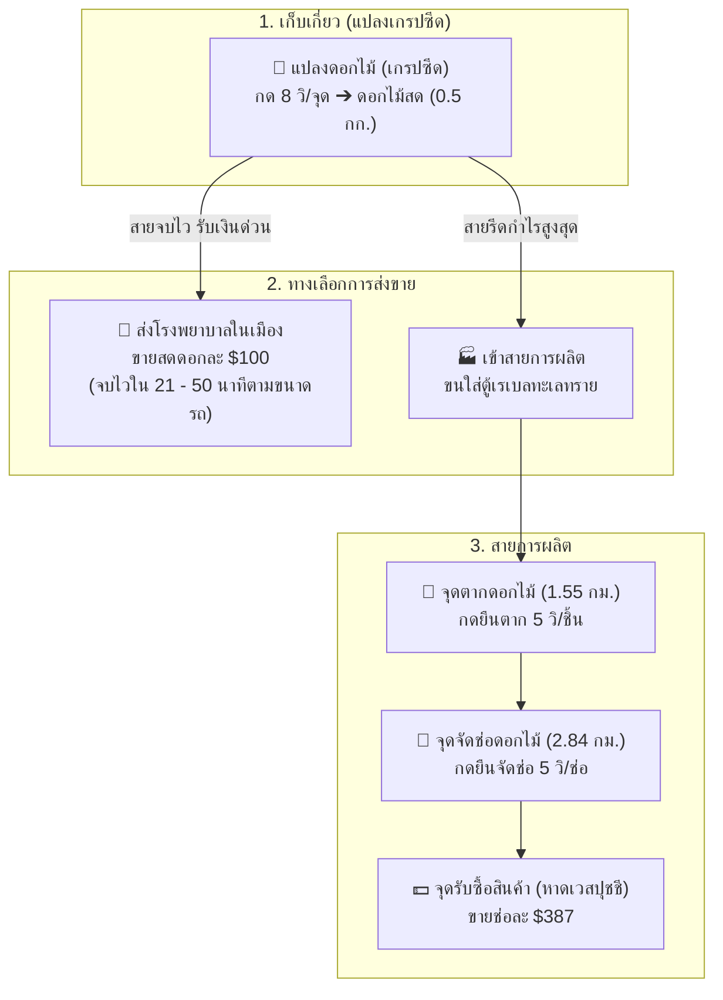

# 🌸 คู่มือคัมภีร์ฟาร์มดอกไม้ฉบับสมบูรณ์ (Flower Farming Master Guide)
> รวมกลไกการผลิต, รูทโลจิสติกส์ 5 เส้นทาง, จุดคุ้มทุน, การจัดประเภทรถ 60 / 120 / 150 กก., การเปรียบเทียบส่ง รพ. vs จัดช่อ, และการคำนวณเปิดคูณ 120k

---

## 📌 สารบัญเนื้อหา
1. [ข้อมูลพื้นฐาน & กลไกของระบบฟาร์มดอกไม้](#1-ข้อมูลพื้นฐาน--กลไกของระบบฟาร์มดอกไม้)
2. [การจัดประเภทรถ & ขีดจำกัดการบรรทุก (60 / 120 / 150 กก.)](#2-การจัดประเภทรถ--ขีดจำกัดการบรรทุก-60--120--150-กก)
3. [ข้อมูลระยะทาง & รูทโลจิสติกส์ 5 เส้นทาง](#3-ข้อมูลระยะทาง--รูทโลจิสติกส์-5-เส้นทาง)
4. [วิเคราะห์ 3 เส้นทางการทำเงิน (ส่ง รพ. vs ตากแห้ง vs จัดช่อ)](#4-วิเคราะห์-3-เส้นทางการทำเงิน-ส่ง-รพ-vs-ตากแห้ง-vs-จัดช่อ)
5. [การคำนวณการเปิดคูณฟาร์ม (บัพคูณ 2 ราคา 120,000 บ.)](#5-การคำนวณการเปิดคูณฟาร์ม-บัพคูณ-2-ราคา-120000-บ)
6. [ตารางเปรียบเทียบผลตอบแทนตามขนาดรถ 3 ประเภท](#6-ตารางเปรียบเทียบผลตอบแทนตามขนาดรถ-3-ประเภท)
7. [ผังงานเชิงกลยุทธ์ (Mermaid Diagrams)](#7-ผังงานเชิงกลยุทธ์-mermaid-diagrams)
8. [กฎเหล็ก & เคล็ดลับเซียนดอกไม้ (Pro Tips)](#8-กฎเหล็ก--เคล็ดลับเซียนดอกไม้-pro-tips)

---

## 1. ข้อมูลพื้นฐาน & กลไกของระบบฟาร์มดอกไม้

### ⚙️ วงจรการผลิตดอกไม้
* **ต้นทุนเริ่มฟาร์ม:** **0 บาท (ฟรี ไม่มีค่าใช้จ่าย)**
* **การเก็บเกี่ยวที่แปลงดอกไม้ (เกรปซีด):**
  * เวลาเก็บ: **8 วินาที / จุด**
  * ผลผลิต: **1 ดอก / จุด** *(วันปกติ)* | **2 ดอก / จุด** *(เมื่อมีคูณ 2)*
* **การแปรรูป (ตากดอกไม้):**
  * อัตราส่วน: ดอกไม้สด 1 ดอก ➔ ดอกไม้แปรรูป 1 ชิ้น
  * เวลาที่ใช้: **5 วินาที / ชิ้น**
* **การบรรจุ (จัดช่อดอกไม้):**
  * อัตราส่วน: ดอกไม้แปรรูป 2 ชิ้น ➔ ช่อดอกไม้ 1 ช่อ
  * เวลาที่ใช้: **5 วินาที / ช่อ**

### 💵 ราคาขายในระบบ
* **ดอกไม้สด (Flower):**
  * ร้าน NPC ทั่วไป: **$80** / ดอก
  * **ส่งโรงพยาบาล (Hospital):** **$100** / ดอก 🌟 *(แพงกว่าร้าน 25%)*
* **ดอกไม้แปรรูป (Processed Flower):** **$145** / ชิ้น
* **ช่อดอกไม้ (Packed Flower):** **$387** / ช่อ *(ส่งหาดเวสปุชชี)*

---

## 2. การจัดประเภทรถ & ขีดจำกัดการบรรทุก (60 / 120 / 150 กก.)

ระบบจำแนกยานพาหนะตามขนาดความจุกระเป๋า เพื่อวางแผนเวลาเก็บเกี่ยวและการแปรรูปได้อย่างแม่นยำ:

### 🎒 น้ำหนักไอเทมแต่ละชนิด
* **ดอกไม้สด (Flower):** **0.50 กก. / ดอก**
* **ดอกไม้แปรรูป (Processed Flower):** **0.50 กก. / ชิ้น**
* **ช่อดอกไม้ (Packed Flower):** **1.00 กก. / ช่อ**

### 🚗 ตารางความจุของรถ 3 ประเภท (The Perfect Ratio ทุกคลาส):

* 🚗 **คลาส A: รถเล็ก / รถเร็ว (ความจุ 60 กิโลกรัม)**
  * **ดอกไม้สด:** จุได้ **120 ดอก**
  * **ดอกไม้แปรรูป:** จุได้ **120 ชิ้น**
  * **ช่อดอกไม้:** จุได้ **60 ช่อ**
  * *จุดเด่น:* วิ่งส่งโรงพยาบาลหรือหาดเวสปุชชีได้รวดเร็วที่สุด ใช้เวลาเก็บเพียง 18 - 20 นาที

* 🚙 **คลาส B: รถขนาดกลาง / กระบะ / SUV (ความจุ 120 กิโลกรัม)**
  * **ดอกไม้สด:** จุได้ **240 ดอก**
  * **ดอกไม้แปรรูป:** จุได้ **240 ชิ้น**
  * **ช่อดอกไม้:** จุได้ **120 ช่อ**
  * *จุดเด่น:* ทำงานรอบละประมาณ 1 ชั่วโมง - 1 ชั่วโมงนิดๆ กำลังพอดี ไม่ล้าสายตา

* 🚚 **คลาส C: รถบรรทุก / ปิคอัพใหญ่ (ความจุ 150 กิโลกรัม)**
  * **ดอกไม้สด:** จุได้ **300 ดอก**
  * **ดอกไม้แปรรูป:** จุได้ **300 ชิ้น**
  * **ช่อดอกไม้:** จุได้ **150 ช่อ**
  * *จุดเด่น:* **The Perfect Ratio สูงสุด** บรรทุกผลผลิตได้คุ้มค่าเวลาขับรถมากที่สุด ได้กำไรต่อเที่ยวเกือบ 6 หมื่นบาท

---

## 3. ข้อมูลระยะทาง & รูทโลจิสติกส์ 5 เส้นทาง

| รูทการเดินทาง | จำนวนจุด | ระยะทาง | รถเร็ว 🚗 (คลาส 60 กก.) | รถบรรทุก 🚚 (คลาส 150 กก.) | จุดประสงค์ |
| :--- | :---: | :---: | :---: | :---: | :--- |
| **1. สวนดอกไม้ ➔ เรเบลทะเลทราย** | 18 จุด | 4.22 กม. | 2 นาที 18 วิ | 3 นาที 37 วิ | ขนดอกไม้สดมาเก็บเข้าตู้ |
| **2. เรเบลทะเลทราย ➔ จุดตากดอกไม้** | 10 จุด | 1.55 กม. | 51 วินาที | 1 นาที 20 วิ | ขนดอกไม้สดไปตากแห้ง |
| **3. เรเบลล่าง ➔ จุดจัดช่อดอกไม้** | 11 จุด | 2.84 กม. | 1 นาที 33 วิ | 2 นาที 26 วิ | ขนดอกไม้ตากแห้งไปเข้าช่อ |
| **4. จุดจัดช่อ ➔ หาดเวสปุชชี** | 12 จุด | 2.63 กม. | 1 นาที 26 วิ | 2 นาที 16 วิ | ส่งช่อดอกไม้ขายร้าน $387 |
| **5. เรเบลล่าง ➔ หาดเวสปุชชี** | 10 จุด | 5.47 กม. | 2 นาที 59 วิ | 4 นาที 42 วิ | ขนช่อดอกไม้จากตู้มาขายตรง |

---

## 4. วิเคราะห์ 3 เส้นทางการทำเงิน

### 🏥 ทางเลือกที่ 1: เก็บสดส่งโรงพยาบาล ($100 / ดอก)
* **การปฏิบัติงาน:** เก็บดอกไม้สดครบตามขนาดรถ ➔ ขับเข้าเมืองส่งโรงพยาบาลทันที (ไม่ต้องตาก ไม่ต้องจัดช่อ)
* **จุดเด่น:** จบงานไวที่สุดในเกม ได้เงินสดแน่นอน เหมาะกับคนมีเวลาจำกัด

### 🥀 ทางเลือกที่ 2: ตากแห้งส่งขาย ($145 / ชิ้น)
* **การปฏิบัติงาน:** เก็บดอกไม้สด ➔ ขับไปตากแห้ง ➔ ขับส่งขายร้านทันที
* **จุดเด่น:** ได้เงินเพิ่มขึ้น 45% จากดอกไม้สด แลกกับการยืนตาก 5 วิ/ชิ้น

### 💐 ทางเลือกที่ 3: จัดช่อส่งหาดเวสปุชชี ($387 / ช่อ) 👑
* **การปฏิบัติงาน:** เก็บดอกไม้สด ➔ ตากแห้ง ➔ ขับไปจุดจัดช่อ ➔ ขับไปส่งหาดเวสปุชชี
* **จุดเด่น:** รีดกำไรสูงสุดทุกดอก ให้ค่าแรงเฉพาะขั้นตอนแปรรูปสูงถึง **~38,250 บาท / ชั่วโมง**

---

## 5. การคำนวณการเปิดคูณฟาร์ม (บัพคูณ 2 ราคา 120,000 บ.)

> **ต้นทุนบัพคูณ 2:** **120,000 บาท (120k)**
> **ผลของบัพ:** เก็บดอกไม้ 1 จุด (8 วินาที) ได้ดอกไม้เพิ่มจาก 1 ดอก ➔ **เป็น 2 ดอก (+1 ดอกฟรีทุกจุด)**

### 🎯 จุดคุ้มทุนของบัพคูณ 120k (Break-Even Analysis)
* **กรณีส่ง รพ. (ดอกละ 100 บ.):** ต้องกดเก็บ **1,200 จุด** (ได้ 2,400 ดอก) ถึงจะคืนทุน 120k
* **กรณีจัดช่อส่งหาด ($387 = ตกดอกละ 193.5 บ.):** ต้องกดเก็บเพียง **620 จุด** (ได้ 1,240 ดอก = จัดได้ 620 ช่อ) ก็คืนทุน 120k แล้ว!

### 🚨 กฎเหล็กวันเปิดคูณ 120k:
1. **ห้ามยืนแปรรูปตอนมีคูณ:** เตาตากและโต๊ะจัดช่อไม่ได้คูณ 2 ให้เก็บดอกไม้สดอย่างเดียว
2. **กลยุทธ์ "สูบใส่ตู้ (Suck & Stash)":** เก็บเต็มรถ ➔ เทตู้เรเบลทะเลทราย ➔ กลับไปเก็บต่อทันที พอหมดเวลาคูณค่อยเอาออกมาแปรรูป

---

## 6. ตารางเปรียบเทียบผลตอบแทนตามขนาดรถ 3 ประเภท

*(ต้นทุนเงินสด: **0 บาท ฟรีทุกขั้นตอน**)*

### 📊 เปรียบเทียบผลผลิต & รายรับต่อ 1 เที่ยวรถ:

| ขนาดรถ | โควตาดอกสด | ช่อดอกไม้ที่ได้ | 🏥 ส่งโรงพยาบาล ($100) | 🥀 ตากแห้งขาย ($145) | 💐 จัดช่อส่งหาด ($387) |
| :---: | :---: | :---: | :---: | :---: | :---: |
| 🚗 **รถ 60 กก.** | 120 ดอก | 60 ช่อ | **12,000 บาท** | **17,400 บาท** | **23,220 บาท** |
| 🚙 **รถ 120 กก.** | 240 ดอก | 120 ช่อ | **24,000 บาท** | **34,800 บาท** | **46,440 บาท** |
| 🚚 **รถ 150 กก.** | 300 ดอก | 150 ช่อ | **30,000 บาท** | **43,500 บาท** | **58,050 บาท** 🥇 |

### ⏱️ เวลาที่ใช้ต่อเที่ยวรถ (สายจัดช่อส่งหาดเวสปุชชี):
* 🚗 **รถ 60 กก.:** เก็บสด ~18 น. + ตาก 10 น. + จัดช่อ 5 น. + ขับรถเร็ว ~6 น. = **~39 นาที** *(ยืนพักดูหนังได้ 15 นาที)*
* 🚙 **รถ 120 กก.:** เก็บสด ~36 น. + ตาก 20 น. + จัดช่อ 10 น. + ขับรถ ~8 น. = **~74 นาที** *(ยืนพักดูหนังได้ 30 นาที)*
* 🚚 **รถ 150 กก.:** เก็บสด ~45 น. + ตาก 25 น. + จัดช่อ 12.5 น. + ขับรถ ~9.6 น. = **~96 นาที** *(ยืนพักดูหนังได้ 37.5 นาที)*

### ⏱️ เวลาที่ใช้ต่อเที่ยวรถ (สายส่งโรงพยาบาล จบไว):
* 🚗 **รถ 60 กก.:** เก็บสด ~18 น. + ขับรถเร็วส่ง รพ. ~3 น. = **~21 นาที** ⚡
* 🚙 **รถ 120 กก.:** เก็บสด ~36 น. + ขับรถส่ง รพ. ~4 น. = **~40 นาที**
* 🚚 **รถ 150 กก.:** เก็บสด ~45 น. + ขับรถส่ง รพ. ~5 น. = **~50 นาที**

---

## 7. ผังงานเชิงกลยุทธ์ (Mermaid Diagrams)

### ผังกระบวนการฟาร์มดอกไม้ครบวงจร

---

## 8. กฎเหล็ก & เคล็ดลับเซียนดอกไม้ (Pro Tips)

1. **เลือกขนาดรถให้ตรงกับเวลาว่าง:**
   * ว่าง 20 นาที ➔ ใช้ **รถ 60 กก.** เก็บส่ง รพ. รับ 12,000 บ. จบใน 21 นาที
   * ว่าง 1 ชั่วโมงกว่า ➔ ใช้ **รถ 120 กก.** เก็บและจัดช่อ รับ 46,440 บ.
   * ว่างชิลล์ๆ 1 ชั่วโมงครึ่ง ➔ ใช้ **รถ 150 กก.** จัดเต็ม รับ 58,050 บ.
2. **การจัดเวลาดูหนัง/พักสายตา:**
   * ช่วงยืนตากดอกไม้และจัดช่อ ตัวละครจะยืนนิ่งหน้าโต๊ะ ให้ใช้เวลานี้ดู YouTube หรือพักมือ (รถ 60 กก. พักได้ 15 น. / รถ 150 กก. พักได้ 37.5 น.)
3. **เทคนิควันเปิดคูณ 120k:**
   * ขุดใส่ตู้ลูกเดียว ห้ามยืนแปรรูปตอนมีคูณเด็ดขาด!
