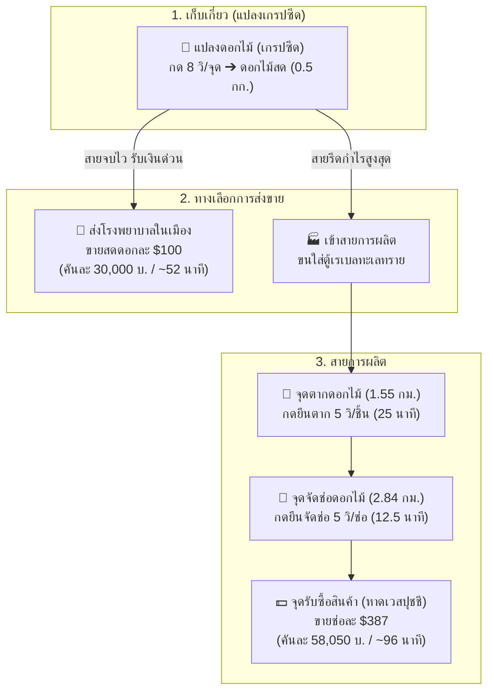

# 🌸 คู่มือคัมภีร์ฟาร์มดอกไม้ฉบับสมบูรณ์ (Flower Farming Master Guide)
> รวมกลไกการผลิต, รูทโลจิสติกส์ 5 เส้นทาง, จุดคุ้มทุน, การเปรียบเทียบส่ง รพ. vs จัดช่อ, และการวิเคราะห์การเปิดคูณ 120k

---

## 📌 สารบัญเนื้อหา
1. [ข้อมูลพื้นฐาน & กลไกของระบบฟาร์มดอกไม้](#1-ข้อมูลพื้นฐาน--กลไกของระบบฟาร์มดอกไม้)
2. [ความจุกระเป๋ารถ & The Perfect Ratio (150 กก.)](#2-ความจุกระเป๋ารถ--the-perfect-ratio-150-กก)
3. [ข้อมูลระยะทาง & รูทโลจิสติกส์ 5 เส้นทาง](#3-ข้อมูลระยะทาง--รูทโลจิสติกส์-5-เส้นทาง)
4. [วิเคราะห์ 3 เส้นทางการทำเงิน (ส่ง รพ. vs ตากแห้ง vs จัดช่อ)](#4-วิเคราะห์-3-เส้นทางการทำเงิน-ส่ง-รพ-vs-ตากแห้ง-vs-จัดช่อ)
5. [การคำนวณการเปิดคูณฟาร์ม (บัพคูณ 2 ราคา 120,000 บ.)](#5-การคำนวณการเปิดคูณฟาร์ม-บัพคูณ-2-ราคา-120000-บ)
6. [การวางแผนกะทำงาน & เป้าหมายรายได้ (Shift Planning)](#6-การวางแผนกะทำงาน--เป้าหมายรายได้-shift-planning)
7. [ผังงานเชิงกลยุทธ์ (Mermaid Diagrams)](#7-ผังงานเชิงกลยุทธ์-mermaid-diagrams)
8. [กฎเหล็ก & เคล็ดลับเซียนดอกไม้ (Pro Tips)](#8-กฎเหล็ก--เคล็ดลับเซียนดอกไม้-pro-tips)

---

## 1. ข้อมูลพื้นฐาน & กลไกของระบบฟาร์มดอกไม้

### ⚙️ วงจรการผลิตดอกไม้
* **ต้นทุนเริ่มฟาร์ม:** **0 บาท (ฟรี ไม่มีค่าใช้จ่าย)**
* **การเก็บเกี่ยวที่แปลงดอกไม้ (เกรปซีด):**
  * เวลาเก็บ: **8 วินาที / จุด**
  * ผลผลิต: **1 ดอก / จุด** *(วันปกติ)* | **2 ดอก / จุด** *(เมื่อมีคูณ 2)*
* **การแปรรูป (ตากดอกไม้):**
  * อัตราส่วน: ดอกไม้สด 1 ดอก ➔ ดอกไม้แปรรูป 1 ชิ้น
  * เวลาที่ใช้: **5 วินาที / ชิ้น**
* **การบรรจุ (จัดช่อดอกไม้):**
  * อัตราส่วน: ดอกไม้แปรรูป 2 ชิ้น ➔ ช่อดอกไม้ 1 ช่อ
  * เวลาที่ใช้: **5 วินาที / ช่อ**

### 💵 ราคาขายในระบบ
* **ดอกไม้สด (Flower):**
  * ร้าน NPC ทั่วไป: **$80** / ดอก
  * **ส่งโรงพยาบาล (Hospital):** **$100** / ดอก 🌟 *(แพงกว่าร้าน 25%)*
* **ดอกไม้แปรรูป (Processed Flower):** **$145** / ชิ้น
* **ช่อดอกไม้ (Packed Flower):** **$387** / ช่อ *(ส่งหาดเวสปุชชี)*

---

## 2. ความจุกระเป๋ารถ & The Perfect Ratio (150 กก.)

### 🎒 น้ำหนักไอเทมแต่ละชนิด
* **ดอกไม้สด (Flower):** **0.50 กก. / ดอก** ➔ รถบรรทุก 150 กก. บรรทุกได้สูงสุด **300 ดอก**
* **ดอกไม้แปรรูป (Processed Flower):** **0.50 กก. / ชิ้น** ➔ รถบรรทุก 150 กก. บรรทุกได้สูงสุด **300 ชิ้น**
* **ช่อดอกไม้ (Packed Flower):** **1.00 กก. / ช่อ** ➔ รถบรรทุก 150 กก. บรรทุกได้สูงสุด **150 ช่อ**

> [!TIP]
> **💡 The Perfect Ratio ของดอกไม้:**
> ดอกไม้สดเต็มรถ 300 ดอก (150 กก.) ➔ ตากแห้งได้ 300 ดอก (150 กก.) ➔ จัดช่อได้ 150 ช่อ (150 กก.)
> น้ำหนักคงที่ 150 กิโลกรัมตลอดทั้งลูป ขนไปแปรรูปและนำช่อดอกไม้ไปขายจบได้ในเที่ยวเดียว ไม่ล้นกระเป๋า

---

## 3. ข้อมูลระยะทาง & รูทโลจิสติกส์ 5 เส้นทาง

| รูทการเดินทาง | จำนวนจุด | ระยะทาง | รถเร็ว 🚗 | รถบรรทุก 🚚 | จุดประสงค์ |
| :--- | :---: | :---: | :---: | :---: | :--- |
| **1. สวนดอกไม้ ➔ เรเบลทะเลทราย** | 18 จุด | 4.22 กม. | 2 นาที 18 วิ | 3 นาที 37 วิ | ขนดอกไม้สดมาเก็บเข้าตู้ |
| **2. เรเบลทะเลทราย ➔ จุดตากดอกไม้** | 10 จุด | 1.55 กม. | 51 วินาที | 1 นาที 20 วิ | ขนดอกไม้สดไปตากแห้ง |
| **3. เรเบลล่าง ➔ จุดจัดช่อดอกไม้** | 11 จุด | 2.84 กม. | 1 นาที 33 วิ | 2 นาที 26 วิ | ขนดอกไม้ตากแห้งไปเข้าช่อ |
| **4. จุดจัดช่อ ➔ หาดเวสปุชชี** | 12 จุด | 2.63 กม. | 1 นาที 26 วิ | 2 นาที 16 วิ | ส่งช่อดอกไม้ขายร้าน $387 |
| **5. เรเบลล่าง ➔ หาดเวสปุชชี** | 10 จุด | 5.47 กม. | 2 นาที 59 วิ | 4 นาที 42 วิ | ขนช่อดอกไม้จากตู้มาขายตรง |

---

## 4. วิเคราะห์ 3 เส้นทางการทำเงิน (ต่อ 1 คันรถ 150 กก.)

*(คิดบนผลผลิตดอกไม้สด 300 ดอก = 1 คันรถบรรทุก)*

| มิติการเปรียบเทียบ | 🏥 1. ส่งโรงพยาบาล ($100) | 🥀 2. ตากแห้งขาย ($145) | 💐 3. จัดช่อส่งหาด ($387) 👑 |
| :--- | :---: | :---: | :---: |
| **ผลผลิตที่ขาย** | ดอกไม้สด 300 ดอก | ดอกไม้แปรรูป 300 ดอก | ช่อดอกไม้ 150 ช่อ |
| **ต้นทุนเงินสด** | **0 บาท (ฟรี)** | **0 บาท (ฟรี)** | **0 บาท (ฟรี)** |
| **💰 รายรับสุทธิ** | **30,000 บาท** | **43,500 บาท** | **58,050 บาท** 🥇 |
| **เวลาเก็บ 300 ดอก (จุดละ 8 วิ)** | ~45 - 50 นาที | ~45 - 50 นาที | ~45 - 50 นาที |
| **เวลายืนตาก (5 วิ/ชิ้น)** | **0 นาที** | 25 นาที | 25 นาที |
| **เวลายืนจัดช่อ (5 วิ/ช่อ)** | **0 นาที** | **0 นาที** | 12.5 นาที |
| **เวลาขับรถวนลูป** | ~4 - 5 นาที *(เข้าเมืองส่ง รพ.)* | ~5 นาที | ~9.6 นาที |
| **⏱️ เวลารวมต่อ 1 คันรถ** | **~52 นาที (~0.87 ชม.)** ⚡ | **~82 นาที (~1.37 ชม.)** | **~96 นาที (~1.60 ชม.)** |
| **🚀 รายได้เฉลี่ยต่อ ชม.** | **~34,500 บ. / ชม.** | **~31,800 บ. / ชม.** | **~36,300 บ. / ชม.** 🔥 |
| **เวลายืนดูหนัง/พักมือ** | 0 นาที *(เก็บแล้วส่ง)* | 25 นาที | **37.5 นาที** 🛋️ |

> [!NOTE]
> **การวิเคราะห์ความคุ้มค่าการแปรรูป:**
> การนำดอกไม้สด (ขาย รพ. 30,000 บ.) มาตากและจัดช่อ (ขายหาด 58,050 บ.) ทำให้ได้เงินเพิ่ม **+28,050 บาท** โดยเสียเวลาทำงานเพิ่ม **44 นาที** คิดเป็น **ค่าแรงการแปรรูปสูงถึง ~38,250 บาท / ชั่วโมง** ซึ่งคุ้มค่าเหนื่อยมาก

---

## 5. การคำนวณการเปิดคูณฟาร์ม (บัพคูณ 2 ราคา 120,000 บ.)

> **ต้นทุนบัพคูณ 2:** **120,000 บาท (120k)**
> **ผลของบัพ:** เก็บดอกไม้ 1 จุด (8 วินาที) ได้ดอกไม้เพิ่มจาก 1 ดอก ➔ **เป็น 2 ดอก (+1 ดอกฟรีทุกจุด)**

### 🎯 จุดคุ้มทุนของบัพคูณ 120k (Break-Even Analysis)
คุณต้องเก็บดอกไม้ให้ได้กี่ดอกถึงจะคืนทุนค่าบัพ 120,000 บาท?

* **กรณีขายดอกไม้สดส่ง รพ. (ดอกละ 100 บ.):**
  * ดอกไม้แถมฟรีสร้างมูลค่าดอกละ 100 บาท
  * ต้องได้ดอกไม้แถม: $120,000 \div 100 =$ **1,200 ดอก**
  * 👉 **ต้องกดเก็บ 1,200 จุด** (เท่ากับผลผลิตรวม 2,400 ดอก = **8 คันรถ**) ถึงจะคืนทุน 120k
* **กรณีนำไปแปรรูปจัดช่อขายหาด ($387 ต่อ 2 ดอก = ตกดอกละ 193.5 บ.):**
  * ดอกไม้แถมฟรีสร้างมูลค่าดอกละ 193.5 บาท
  * ต้องได้ดอกไม้แถม: $120,000 \div 193.5 =$ **620 ดอก**
  * 👉 **ต้องกดเก็บเพียง 620 จุด** (เท่ากับผลผลิตรวม 1,240 ดอก = **~4.1 คันรถ**) ก็คืนทุน 120k แล้ว!

---

### ⏱️ ความเร็วการเก็บในชั่วโมงคูณ 2 (Speed Harvesting Formula)
* **ปกติ (ไม่มีคูณ):** เก็บ 300 ดอก (1 คันรถ) ใช้เวลาเก็บ ~40 - 50 นาที
* **เมื่อมีคูณ 2:** เก็บแค่ **150 จุด** ก็ได้ครบ 300 ดอกเต็มรถ (150 กก.)
  * ใช้เวลากดเก็บเพียง: $150 \times 8 =$ 1,200 วินาที = **20 นาทีเท่านั้น!** (เร็วขึ้นเท่าตัว)

---

### 🚨 กฎเหล็กวันเปิดคูณ 120k (The Golden Double-Drop Rules)

1. **ห้ามเสียเวลาแปรรูปหรือจัดช่อตอนที่บัพคูณ 2 ยังทำงานอยู่เด็ดขาด!**
   * เตาตากดอกไม้และโต๊ะจัดช่อ **ไม่ได้คูณ 2** 
   * การมายืนกดตากดอกไม้ตอนมีคูณ เท่ากับคุณกำลังเผาเงินค่าบัพ 120k ทิ้งไปนาทีละ 2,000 บาท!
2. **กลยุทธ์ "สูบใส่ตู้ (Suck & Stash)":**
   * ในช่วงเวลาที่บัพคูณเปิด ให้ทำแค่ **เก็บดอกไม้ใส่รถ ➔ ขับมาเทใส่ตู้เรเบลทะเลทราย ➔ ขับกลับไปเก็บต่อ** วนลูปเท่านั้น!
   * 1 คันรถ (300 ดอก) จะใช้เวลาเพียง **~27 นาที** (เก็บ 20 น. + ขับไปกลับตู้ 7 น.)
   * ใน 1 ชั่วโมง จะขนดอกไม้สดเข้าตู้ได้ถึง **600 ดอก (2 คันรถ)**
   * ใน 2 ชั่วโมง จะขนได้ถึง **1,200 ดอก (4 คันรถ = คืนทุน 120k ทันทีถ้าเอาไปจัดช่อ!)**
3. **การแชร์ตี้แก๊ง (Party/Gang Sharing):**
   * ถ้าบัพ 120k เป็นแบบคูณทั้งตี้หรือทั้งแก๊ง ให้เกณฑ์คนมาช่วยกันเก็บ 2 - 4 คน
   * แค่ 2 คนช่วยกันเก็บ 1 ชั่วโมง ก็ได้ดอกไม้รวม 1,200 ดอก (**คืนทุน 120k ได้ภายในชั่วโมงเดียว!**)

---

### 📊 ตารางเปรียบเทียบผลตอบแทน: ไม่เปิดคูณ vs เปิดคูณ 120k (ทำ 4 คันรถ = 1,200 ดอก)

| รายการเปรียบเทียบ | ไม่เปิดคูณ (ปกติ) | เปิดคูณ 120k (สูบใส่ตู้แล้วค่อยแปรรูป) |
| :--- | :---: | :---: |
| **จำนวนดอกไม้ที่ได้** | 1,200 ดอก (จัดได้ 600 ช่อ) | 1,200 ดอก (จัดได้ 600 ช่อ) |
| **เวลากดเก็บดอกไม้** | ~190 นาที (~3.1 ชม.) | **~80 นาที (~1.3 ชม.)** ⚡ *(เร็วขึ้น 1.8 ชม.)* |
| **รายรับจากการขาย 600 ช่อ** | 232,200 บาท | 232,200 บาท |
| **หักค่าบัพคูณ** | 0 บาท | -120,000 บาท |
| **กำไรสุทธิหลังหักบัพ** | **232,200 บาท** | **112,200 บาท** |
| **บทวิเคราะห์ความคุ้มค่า** | ได้เงินเต็มเม็ดเต็มหน่วย | ซื้อเวลาชีวิต ประหยัดเวลากดไปเกือบ 2 ชั่วโมง |

> [!IMPORTANT]
> **สรุปความคุ้มค่าของการเปิดคูณ 120k:**
> * **ถ้าเล่นคนเดียว 1-2 ชั่วโมง:** **"ไม่แนะนำให้เปิด"** เพราะค่าบัพ 120k จะกินกำไรไปเกือบหมด
> * **ถ้าเล่นยาว 4 ชั่วโมงขึ้นไป หรือมีเพื่อนช่วยเก็บ 2-3 คน:** **"คุ้มค่ามาก"** เพราะประหยัดเวลาเก็บได้มหาศาล และปั๊มดอกไม้เข้าตู้ได้เป็นพันๆ ดอก

---

## 6. การวางแผนกะทำงาน & เป้าหมายรายได้ (Shift Planning)

สำหรับคนที่ต้องการเล่นสายฟาร์มดอกไม้แบบจริงจัง นี่คือตารางคำนวณเป้าหมายผลผลิตและรายได้ตามเวลาที่คุณมีในแต่ละวัน:

| กะการทำงาน (เวลาที่เล่น) | จำนวนคันรถ (150 กก.) | ปริมาณดอกไม้สด | 💐 จำนวนช่อดอกไม้ ($387) | 💰 รายรับสุทธิ (จัดช่อส่งหาด) | 🏥 ทางเลือกส่ง รพ. ($100) |
| :---: | :---: | :---: | :---: | :---: | :---: |
| **~1.6 ชั่วโมง** | 1 คันรถ | 300 ดอก | 150 ช่อ | **58,050 บาท** | 30,000 บาท *(~52 นาที)* |
| **~3.2 ชั่วโมง** | 2 คันรถ | 600 ดอก | 300 ช่อ | **116,100 บาท** | 60,000 บาท |
| **~4.8 ชั่วโมง** | 3 คันรถ | 900 ดอก | 450 ช่อ | **174,150 บาท** | 90,000 บาท |
| **~6.4 ชั่วโมง** | 4 คันรถ | 1,200 ดอก | 600 ช่อ | **232,200 บาท** | 120,000 บาท |
| **~8.0 ชั่วโมง** | 5 คันรถ | 1,500 ดอก | 750 ช่อ | **290,250 บาท** | 150,000 บาท |

> 💡 **การจัดสรรเวลาใน 1 คันรถ (96 นาที):**
> * **เวลาเดินเก็บในแปลง:** ~45 - 50 นาที *(เหนื่อยปานกลาง เก็บ 8 วิ/จุด)*
> * **เวลายืนนิ่งหน้าโต๊ะ:** **37.5 นาที** *(ตาก 25 น. + จัดช่อ 12.5 น.) ➔ ช่วงนี้เปิดดู YouTube / ซีรีส์ได้สบายๆ*
> * **เวลาขับรถวนส่ง:** ~9.6 นาที

---

## 7. ผังงานเชิงกลยุทธ์ (Mermaid Diagrams)

### ผังกระบวนการฟาร์มดอกไม้ครบวงจร

---

## 8. กฎเหล็ก & เคล็ดลับเซียนดอกไม้ (Pro Tips)

1. **ถ้ามีเวลาเล่นแค่ 1 ชั่วโมง ➔ วิ่งส่งโรงพยาบาล ($100):**
   * เก็บ 1 คันรถ (300 ดอก) ใช้เวลา ~45 นาที ขับส่ง รพ. 5 นาที รับเงินสด **30,000 บาท** เข้าตัวทันทีใน 50 นาที
2. **ถ้ามีเวลาเล่นยาว ➔ ต้องจัดช่อส่งหาดเวสปุชชี ($387):**
   * การตากและจัดช่อให้ค่าแรงสูงถึง **~38,250 บาท/ชั่วโมง** ได้เงินเต็มเม็ดเต็มหน่วย 58,050 บาทต่อคัน
3. **จัดเวลาดูหนัง 37.5 นาที:**
   * ช่วงยืนตากดอกไม้ (25 นาที) และช่วงจัดช่อ (12.5 นาที) ตัวละครจะยืนนิ่งหน้าโต๊ะ ให้ใช้เวลานี้ดู YouTube หรือพักสายตา
4. **หากเปิดคูณ 120k:** ท่องจำให้ขึ้นใจ **"ขุดใส่ตู้ลูกเดียว ห้ามยืนแปรรูปในชั่วโมงคูณเด็ดขาด!"**
