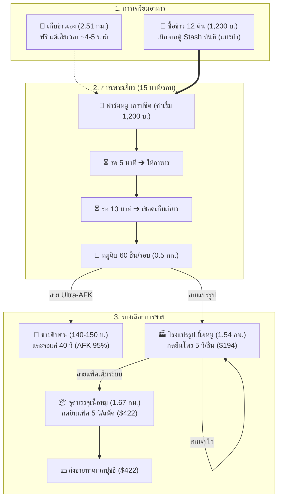

# 🐷 คู่มือคัมภีร์ฟาร์มหมูฉบับสมบูรณ์ (Pork Farming Master Guide)
> รวมกลไกการผลิต, การคำนวณต้นทุน-กำไร, รูทโลจิสติกส์, จุดคุ้มทุน, การจัดประเภทรถ 60 / 120 / 150 กก., ตารางพกข้าว, และ 5 โมเดลกลยุทธ์เชิงลึก

---

## 📌 สารบัญเนื้อหา
1. [ข้อมูลพื้นฐาน & กลไกของระบบฟาร์มหมู](#1-ข้อมูลพื้นฐาน--กลไกของระบบฟาร์มหมู)
2. [ระบบราคาตลาด & จุดคุ้มทุน (Break-Even Analysis)](#2-ระบบราคาตลาด--จุดคุ้มทุน-break-even-analysis)
3. [การจัดประเภทรถ & ขีดจำกัดการบรรทุก (60 / 120 / 150 กก.)](#3-การจัดประเภทรถ--ขีดจำกัดการบรรทุก-60--120--150-กก)
   * [ตารางจำนวนข้าวที่ต้องพกไปใช้ต่อทริป](#ตารางจำนวนข้าวที่ต้องพกไปใช้ต่อทริป)
   * [กลไก Zero Overweight (ทำไมพกข้าวไป น้ำหนักถึงไม่ล้นรถ?)](#กลไก-zero-overweight-ทำไมพกข้าวไป-น้ำหนักถึงไม่ล้นรถ)
   * [จำนวนข้าวสูงสุดสำหรับการขนมาสต็อกใส่ตู้](#จำนวนข้าวสูงสุดสำหรับการขนมาสต็อกใส่ตู้)
4. [ข้อมูลระยะทาง & รูทโลจิสติกส์การเดินทาง](#4-ข้อมูลระยะทาง--รูทโลจิสติกส์การเดินทาง)
5. [เจาะลึก 5 โมเดลกลยุทธ์การเล่น (The 5 Master Strategies)](#5-เจาะลึก-5-โมเดลกลยุทธ์การเล่น-the-5-master-strategies)
   * [โมเดล 1: สาย Ultra-AFK (เลี้ยงเอง ➔ ขายหมูดิบให้คน 140 - 150 บ.)](#โมเดล-1-สาย-ultra-afk-เลี้ยงเอง--ขายหมูดิบให้คน-140---150-บ)
   * [โมเดล 2: สายจบไวคุ้มเวลา (เลี้ยงเอง ➔ โพร ➔ ขาย $194 บ.)](#โมเดล-2-สายจบไวคุ้มเวลา-เลี้ยงเอง--โพร--ขาย-194-บ)
   * [โมเดล 3: สายครบวงจรรีดกำไรสูงสุด (เลี้ยงเอง ➔ โพร ➔ แพ็ค ➔ ขาย $422 บ.)](#โมเดล-3-สายครบวงจรรีดกำไรสูงสุด-เลี้ยงเอง--โพร--แพ็ค--ขาย-422-บ)
   * [โมเดล 4: สายโรงงานแปรรูป / พ่อค้าคนกลาง (รับซื้อ 130 - 140 บ. ➔ แพ็คขาย $422 บ.)](#โมเดล-4-สายโรงงานแปรรูป--พ่อค้าคนกลาง-รับซื้อ-130---140-บ--แพ็คขาย-422-บ)
   * [โมเดล 5: สายไฮบริด (Hybrid Mega-Enterprise: เลี้ยงเองควบรับซื้อ)](#โมเดล-5-สายไฮบริด-hybrid-mega-enterprise-เลี้ยงเองควบรับซื้อ)
6. [ตารางเปรียบเทียบผลตอบแทนตามขนาดรถ 3 ประเภท](#6-ตารางเปรียบเทียบผลตอบแทนตามขนาดรถ-3-ประเภท)
7. [ผังงานเชิงกลยุทธ์ (Mermaid Diagrams)](#7-ผังงานเชิงกลยุทธ์-mermaid-diagrams)
8. [กฎเหล็ก & เคล็ดลับเซียนหมู (Pro Tips & Best Practices)](#8-กฎเหล็ก--เคล็ดลับเซียนหมู-pro-tips--best-practices)

---

## 1. ข้อมูลพื้นฐาน & กลไกของระบบฟาร์มหมู

### ⚙️ วงจรการเพาะเลี้ยงต่อ 1 รอบ
* **ต้นทุนเริ่มเลี้ยง:** **1,200 บาท / รอบ**
* **อาหารที่ใช้:** ข้าว **12 ต้น / รอบ**
  * *ทางเลือกซื้อข้าว (แนะนำ):* ต้นละ 100 บาท ➔ **1,200 บาท / รอบ**
  * *ทางเลือกเก็บข้าวเอง:* ขับรถไปเก็บที่ฟาร์มข้าว (ฟรี แต่เสียเวลา ~4-5 นาที)
  * 👉 **ต้นทุนเงินสดรวมต่อ 1 รอบ (กรณีซื้อข้าว):** $1,200 + 1,200 =$ **2,400 บาท**
* **เวลารอหมูโต:**
  * ช่วงที่ 1: รอให้อาหาร **5 นาที**
  * ช่วงที่ 2: รอหมูโตเต็มวัย **10 นาที**
  * ⏱️ **เวลารวมต่อรอบ:** **15 นาที / รอบ**
* **ผลผลิตที่ได้:** **หมูดิบ 60 ชิ้น / รอบ** (น้ำหนักชิ้นละ 0.50 กก. = รวม 30 กก.)

### 🏭 ขั้นตอนการแปรรูป (Processing Pipeline)
1. **หมูดิบ (Raw Pork):** ได้จากฟาร์มโดยตรง ขายได้ทันที
2. **หมูโพร (Processed Pork):** 
   * อัตราส่วน: หมูดิบ 1 ชิ้น ➔ หมูโพร 1 ชิ้น (ใช้เวลากด **5 วินาที / ชิ้น**)
   * 1 รอบ (60 ชิ้น) ใช้เวลายืนกด **5 นาที**
3. **หมูแพ็ค (Packed Pork):** 
   * อัตราส่วน: หมูโพร 2 ชิ้น ➔ หมูแพ็ค 1 แพ็ค (ใช้เวลากด **5 วินาที / แพ็ค**)
   * 1 รอบ (60 ชิ้นโพร ➔ 30 แพ็ค) ใช้เวลายืนกด **2.5 นาที**

---

## 2. ระบบราคาตลาด & จุดคุ้มทุน (Break-Even Analysis)

### 💵 ราคาขายในตลาดและระบบจริง
* **หมูดิบ (Raw Pork):**
  * ร้าน NPC รับซื้อ: **$122** / ชิ้น
  * ขายให้ผู้เล่นคนอื่น: **130 - 150 บาท / ชิ้น**
* **หมูโพร (Processed Pork):** ร้าน NPC รับซื้อ **$194** / ชิ้น
* **หมูแพ็ค (Packed Pork):** ร้าน NPC รับซื้อ **$422** / แพ็ค *(ส่งหาดเวสปุชชี)*

### 💀 จุดขาดทุนเงินสด (Cash Break-Even: ต่ำกว่านี้คือเข้าเนื้อ)
*(คิดจากต้นทุนรอบละ 2,400 บาท ซื้อข้าว 100 บ.)*
* **หมูดิบ:** ต้นทุนต่อชิ้นอยู่ที่ $2,400 \div 60 =$ **40 บาท / ชิ้น** (ขายต่ำกว่า 40 บ. = ขาดทุนเงินสด)
* **หมูโพร:** ต้นทุนต่อชิ้นอยู่ที่ **40 บาท / ชิ้น**
* **หมูแพ็ค:** ต้นทุนต่อแพ็คอยู่ที่ $2,400 \div 30 =$ **80 บาท / แพ็ค**

### 🚨 จุดขาดทุนกำไร (Floor Price: ต่ำกว่านี้ห้ามขายคนเด็ดขาด)
* **หมูดิบ:** ร้าน NPC รับซื้อขั้นต่ำ **$122** ถ้ามีคนขอซื้อต่ำกว่า 122 บ. **ให้โยนร้าน NPC ทันที**

---

## 3. การจัดประเภทรถ & ขีดจำกัดการบรรทุก (60 / 120 / 150 กก.)

ระบบจำแนกยานพาหนะตามขนาดความจุกระเป๋า เพื่อวางแผนรอบการเลี้ยงหมูและการพกพาอาหารให้พอดีเป๊ะ ไม่ล้นและไม่เสียเที่ยว:

### 🚗 ความจุของรถ 3 ประเภท:

* 🚗 **คลาส A: รถเล็ก / รถเร็ว (ความจุ 60 กิโลกรัม)**
  * **โควตาเลี้ยง:** **2 รอบพอดี**
  * **หมูดิบ:** จุได้ **120 ชิ้น** (60 กก.)
  * **หมูโพร:** จุได้ **120 ชิ้น** (60 กก.)
  * **หมูแพ็ค:** จุได้ **60 แพ็ค** (60 กก.)
  * *จุดเด่น:* ขับเร็ว คล่องตัว เหมาะกับคนมีเวลาฟาร์มสั้นๆ รอบละ ~49 นาที

* 🚙 **คลาส B: รถขนาดกลาง / กระบะ / SUV (ความจุ 120 กิโลกรัม)**
  * **โควตาเลี้ยง:** **4 รอบพอดี**
  * **หมูดิบ:** จุได้ **240 ชิ้น** (120 กก.)
  * **หมูโพร:** จุได้ **240 ชิ้น** (120 กก.)
  * **หมูแพ็ค:** จุได้ **120 แพ็ค** (120 กก.)
  * *จุดเด่น:* จุดสมดุลระหว่างความเร็วและความจุ ทำงานรอบละ ~1.5 ชั่วโมง

* 🚚 **คลาส C: รถบรรทุก / ปิคอัพใหญ่ (ความจุ 150 กิโลกรัม)**
  * **โควตาเลี้ยง:** **5 รอบพอดี**
  * **หมูดิบ:** จุได้ **300 ชิ้น** (150 กก.)
  * **หมูโพร:** จุได้ **300 ชิ้น** (150 กก.)
  * **หมูแพ็ค:** จุได้ **150 แพ็ค** (150 กก.)
  * *จุดเด่น:* **The Perfect Ratio สูงสุด** ขนส่งได้คุ้มค่าเวลามากที่สุด ได้กำไรต่อเที่ยวเกิน 5 หมื่นบาท

---

### 🌾 ตารางจำนวนข้าวที่ต้องพกไปใช้ต่อทริป

*(คำนวณจากกฎ: **หมู 1 รอบ = ใช้ข้าว 12 ต้น** | ข้าวหนักต้นละ 0.50 กก.)*

| ขนาดความจุกระเป๋ารถ | โควตาเลี้ยงหมู | 🌾 ข้าวที่ต้องพกไปใช้ | น้ำหนักข้าว | 💵 ค่าข้าวต่อทริป (ซื้อ 100 บ.) |
| :---: | :---: | :---: | :---: | :---: |
| 🚗 **รถ 60 กก.** | **2 รอบ** | **24 ต้น** | 12 กก. | **2,400 บาท** |
| 🚙 **รถ 120 กก.** | **4 รอบ** | **48 ต้น** | 24 กก. | **4,800 บาท** |
| 🚚 **รถ 150 กก.** | **5 รอบ** | **60 ต้น** | 30 กก. | **6,000 บาท** |

---

### 💡 กลไก Zero Overweight (ทำไมพกข้าวไป น้ำหนักถึงไม่ล้นรถ?)

หากคุณพกข้าวใส่รถไปฟาร์มตั้งแต่ต้น น้ำหนักในกระเป๋ารถจะ **ไม่มีวันล้นเด็ดขาด 100%** เพราะข้าวจะถูกใช้กินไปก่อนที่หมูดิบจะถูกเก็บขึ้นรถ:

> **ตัวอย่างวงจรน้ำหนักในรถ 150 กก. (พกข้าว 60 ต้น = 30 กก.):**
> 1. **เริ่มรอบที่ 1:** ให้ข้าว 12 ต้น (-6 กก.) ➔ รถเหลือ 24 กก. ➔ เก็บหมู 60 ชิ้น (+30 กก.) ➔ **รถหนัก 54 กก.**
> 2. **เริ่มรอบที่ 2:** ให้ข้าว 12 ต้น (-6 กก.) ➔ รถเหลือ 48 กก. ➔ เก็บหมู 60 ชิ้น (+30 กก.) ➔ **รถหนัก 78 กก.**
> 3. **เริ่มรอบที่ 3:** ให้ข้าว 12 ต้น (-6 กก.) ➔ รถเหลือ 72 กก. ➔ เก็บหมู 60 ชิ้น (+30 กก.) ➔ **รถหนัก 102 กก.**
> 4. **เริ่มรอบที่ 4:** ให้ข้าว 12 ต้น (-6 กก.) ➔ รถเหลือ 96 กก. ➔ เก็บหมู 60 ชิ้น (+30 กก.) ➔ **รถหนัก 126 กก.**
> 5. **เริ่มรอบที่ 5:** ให้ข้าว 12 ต้นสุดท้ายหมดเกลี้ยง (ข้าวเหลือ 0 กก.) ➔ เก็บหมู 60 ชิ้น (+30 กก.) ➔ **เต็มความจุ 150 กก. พอดีเป๊ะ!**

---

### 📦 จำนวนข้าวสูงสุดสำหรับการขนมาสต็อกใส่ตู้
*(กรณีขนข้าวเปล่าๆ มาหยอดใส่ตู้ Cloud Stash ทีเดียว)*
* 🚗 **รถ 60 กก.:** ขนมาตุนได้สูงสุด **120 ต้น** (ใช้เลี้ยงได้ 10 รอบ)
* 🚙 **รถ 120 กก.:** ขนมาตุนได้สูงสุด **240 ต้น** (ใช้เลี้ยงได้ 20 รอบ)
* 🚚 **รถ 150 กก.:** ขนมาตุนได้สูงสุด **300 ต้น** (ใช้เลี้ยงได้ 25 รอบ)

---

## 4. ข้อมูลระยะทาง & รูทโลจิสติกส์การเดินทาง

*(ระบบแชร์คลัง: ตู้เก็บของทั้ง 2 จุดเป็น Shared Cloud Stash ฝากที่หนึ่ง เบิกอีกที่หนึ่งได้ทันที)*

| เส้นทาง | ระยะทาง | รถเร็ว 🚗 (คลาส 60 กก.) | รถบรรทุก 🚚 (คลาส 150 กก.) | จุดประสงค์ |
| :--- | :---: | :---: | :---: | :--- |
| **1. ตู้ ➔ ฟาร์มหมู (เกรปซีด)** | 2.30 กม. | 1:15 นาที | 1:58 นาที | ไปเริ่มเลี้ยง / ให้อาหาร / เก็บหมู |
| **2. ตู้ล่าง ➔ โรงแปรรูปเนื้อหมู** | 1.54 กม. | 51 วินาที | 1:20 นาที | นำหมูดิบไปแปรรูป (โพร) |
| **3. โรงแปรรูป ➔ จุดบรรจุเนื้อหมู** | 1.67 กม. | 55 วินาที | 1:26 นาที | นำหมูโพรไปแพ็ค |
| **4. จุดบรรจุ ➔ จุดรับซื้อ (หาดเวสปุชชี)** | 2.80 กม. | 1:32 นาที | 2:24 นาที | เอาหมูแพ็คไปส่งขาย $422 |
| **5. ตู้บน ➔ ฟาร์มข้าว** | 2.51 กม. | 1:22 นาที | 2:09 นาที | ไปเก็บข้าว (กรณีไม่ซื้อข้าว) |

---

## 5. เจาะลึก 5 โมเดลกลยุทธ์การเล่น (The 5 Master Strategies)

### โมเดล 1: สาย Ultra-AFK (เลี้ยงเอง ➔ ขายหมูดิบให้คน 140 - 150 บ.)
* **การปฏิบัติงาน:** เลี้ยงตามขนาดรถ ➔ ไม่เข้าโรงงานแปรรูป ➔ ส่งขายให้คนรับซื้อที่ตู้ทันที
* **เวลาเฝ้าจอ:** แตะจอแค่รอบละ ~40 วินาที ที่เหลือนอนพัก/AFK 95% ของเวลา

### โมเดล 2: สายจบไวคุ้มเวลา (เลี้ยงเอง ➔ โพร ➔ ขาย $194 บ.)
* **การปฏิบัติงาน:** เลี้ยงครบโควตารถ ➔ ขับไปโรงแปรรูปโพร ➔ ขายร้าน $194 ทันที (ตัดขั้นตอนแพ็คทิ้ง)
* **จุดเด่น:** ประหยัดเวลาขับรถและเวลายืนแพ็ค ได้เงินไว จบงานเร็วกว่าสายแพ็ค 15 นาที

### โมเดล 3: สายครบวงจรรีดกำไรสูงสุด (เลี้ยงเอง ➔ โพร ➔ แพ็ค ➔ ขาย $422 บ.)
* **การปฏิบัติงาน:** เลี้ยงครบโควตารถ ➔ โพร ➔ ขับไปจุดบรรจุแพ็ค ➔ ขายหาดเวสปุชชี $422
* **จุดเด่น:** ได้กำไรเงินสดสูงสุดต่อตัว เหมาะกับคนเล่นรอบน้อยก่อนปิดคอม

### โมเดล 4: สายโรงงานแปรรูป / พ่อค้าคนกลาง (รับซื้อ 130 - 140 บ. ➔ แพ็คขาย $422 บ.)
* **การปฏิบัติงาน:** รับซื้อหมูดิบจากผู้เล่นอื่นใส่ตู้ ➔ ขนไปโพรและแพ็คขายรัวๆ ไม่ต้องรอหมูโต
* **จุดเด่น:** ปั๊มเงินสด Non-Stop ชั่วโมงละกว่า 3.2 หมื่นบาท (เมื่อรับซื้อที่ 130 บ.)

### โมเดล 5: สายไฮบริด (Hybrid Mega-Enterprise: เลี้ยงเองควบรับซื้อ)
* **การปฏิบัติงาน:** เลี้ยงหมูตัวเองเพื่อกินกำไรเต็ม + เปิดรับซื้อหมูคนอื่นมาตุนไว้ในตู้ แล้วเข้าโหมดแปรรูปรวดเดียว

---

## 6. ตารางเปรียบเทียบผลตอบแทนตามขนาดรถ 3 ประเภท

*(คำนวณกรณีซื้อข้าว 100 บ. ต้นทุนรอบละ 2,400 บาท)*

### 📊 เปรียบเทียบผลผลิต & กำไรสุทธิต่อเที่ยวรถ:

| ขนาดรถ | โควตาหมูดิบ | หมูแพ็คที่ได้ | ต้นทุนเงินสด | 🥩 ขายดิบคน ($140) | 🥩 ขายดิบคน ($150) | 🥓 โพรขาย ($194) | 📦 แพ็คขาย ($422) |
| :---: | :---: | :---: | :---: | :---: | :---: | :---: | :---: |
| 🚗 **รถ 60 กก.** (2 รอบ) | 120 ชิ้น | 60 แพ็ค | -4,800 บ. | **+12,000 บ.** | **+13,200 บ.** | **+18,480 บ.** | **+20,520 บ.** |
| 🚙 **รถ 120 กก.** (4 รอบ) | 240 ชิ้น | 120 แพ็ค | -9,600 บ. | **+24,000 บ.** | **+26,400 บ.** | **+36,960 บ.** | **+41,040 บ.** |
| 🚚 **รถ 150 กก.** (5 รอบ) | 300 ชิ้น | 150 แพ็ค | -12,000 บ. | **+30,000 บ.** | **+33,000 บ.** | **+46,200 บ.** | **+51,300 บ.** |

### ⏱️ เวลาที่ใช้ต่อเที่ยวรถ (สายแพ็คขาย $422):
* 🚗 **รถ 60 กก. (2 รอบ):** เวลารอโต 30 น. + โพร 10 น. + แพ็ค 5 น. + ขับรถ ~4 น. = **~49 นาที** *(ดูหนัง 15 น.)*
* 🚙 **รถ 120 กก. (4 รอบ):** เวลารอโต 60 น. + โพร 20 น. + แพ็ค 10 น. + ขับรถ ~6 น. = **~96 นาที** *(ดูหนัง 30 น.)*
* 🚚 **รถ 150 กก. (5 รอบ):** เวลารอโต 75 น. + โพร 25 น. + แพ็ค 12.5 น. + ขับรถ ~8.5 น. = **~121 นาที** *(ดูหนัง 37.5 น.)*

---

## 7. ผังงานเชิงกลยุทธ์ (Mermaid Diagrams)

### ผังวงจรการผลิตหมูครบวงจร

---

## 8. กฎเหล็ก & เคล็ดลับเซียนหมู (Pro Tips & Best Practices)

1. **พกข้าวให้พอดีรอบรถ:**
   * รถ 60 กก. ➔ พกข้าว **24 ต้น**
   * รถ 120 กก. ➔ พกข้าว **48 ต้น**
   * รถ 150 กก. ➔ พกข้าว **60 ต้น**
2. **น้ำหนักไม่มีวันล้น:** ข้าวจะถูกกินไปก่อนเก็บหมู ดังนั้นพกข้าวใส่รถไปได้เลยโดยไม่ต้องกังวลเรื่องน้ำหนักเกิน
3. **เทคนิค Dual-Timer:**
   * กดเริ่มเลี้ยง ➔ ตั้งปลุก **5 นาที** (ให้อาหาร)
   * ให้อาหารเสร็จ ➔ ตั้งปลุก **10 นาที** (เชือดเก็บหมู)
4. **ระวังกับดักรับซื้อ 150 บาท:**
   * ถ้าราคาหมูดิบ 150 บ. ให้เปลี่ยนไปเป็น "คนเลี้ยงขายดิบ" ทันที จะได้เงินเท่ากับคนแปรรูปโดยไม่ต้องเหนื่อยทำงาน!
