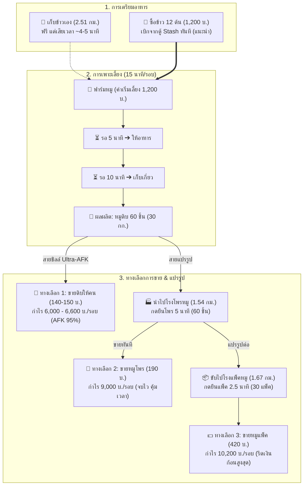
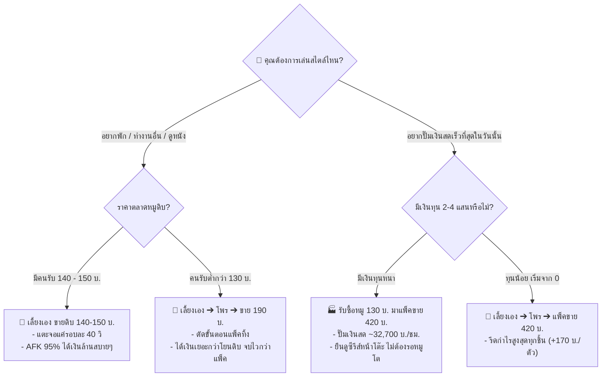

# 🐷 คู่มือคัมภีร์ฟาร์มหมูฉบับสมบูรณ์ (Pork Farming Master Guide)
> รวมกลไกการผลิต, การคำนวณต้นทุน-กำไร, รูทโลจิสติกส์, จุดคุ้มทุน, และ 5 โมเดลกลยุทธ์เชิงลึก (ตั้งแต่สาย Ultra-AFK จนถึงสายโรงงานแปรรูปเงินล้าน)

---

## 📌 สารบัญเนื้อหา
1. [ข้อมูลพื้นฐาน & กลไกของระบบฟาร์มหมู](#1-ข้อมูลพื้นฐาน--กลไกของระบบฟาร์มหมู)
2. [ระบบราคาตลาด & จุดคุ้มทุน (Break-Even Analysis)](#2-ระบบราคาตลาด--จุดคุ้มทุน-break-even-analysis)
3. [ความจุกระเป๋ารถ & รูทโลจิสติกส์ (Logistics & Capacity)](#3-ความจุกระเป๋ารถ--รูทโลจิสติกส์-logistics--capacity)
4. [เจาะลึก 5 โมเดลกลยุทธ์การเล่น (The 5 Master Strategies)](#4-เจาะลึก-5-โมเดลกลยุทธ์การเล่น-the-5-master-strategies)
   * [โมเดล 1: สาย Ultra-AFK (เลี้ยงเอง ➔ ขายหมูดิบให้คน 140 - 150 บ.)](#โมเดล-1-สาย-ultra-afk-เลี้ยงเอง--ขายหมูดิบให้คน-140---150-บ)
   * [โมเดล 2: สายจบไวคุ้มเวลา (เลี้ยงเอง ➔ โพร ➔ ขาย 190 บ.)](#โมเดล-2-สายจบไวคุ้มเวลา-เลี้ยงเอง--โพร--ขาย-190-บ)
   * [โมเดล 3: สายครบวงจรรีดกำไรสูงสุด (เลี้ยงเอง ➔ โพร ➔ แพ็ค ➔ ขาย 420 บ.)](#โมเดล-3-สายครบวงจรรีดกำไรสูงสุด-เลี้ยงเอง--โพร--แพ็ค--ขาย-420-บ)
   * [โมเดล 4: สายโรงงานแปรรูป / พ่อค้าคนกลาง (รับซื้อ 130 - 140 บ. ➔ แพ็คขาย 420 บ.)](#โมเดล-4-สายโรงงานแปรรูป--พ่อค้าคนกลาง-รับซื้อ-130---140-บ--แพ็คขาย-420-บ)
   * [โมเดล 5: สายไฮบริด (Hybrid Mega-Enterprise: เลี้ยงเองควบรับซื้อ)](#โมเดล-5-สายไฮบริด-hybrid-mega-enterprise-เลี้ยงเองควบรับซื้อ)
5. [ตารางเปรียบเทียบมหากาพย์ (Comprehensive Benchmarks)](#5-ตารางเปรียบเทียบมหากาพย์-comprehensive-benchmarks)
   * [เปรียบเทียบต่อ 1 คันรถบรรทุก (150 กก.)](#เปรียบเทียบต่อ-1-คันรถบรรทุก-150-กก)
   * [เปรียบเทียบในเวลาทำงาน 1 กะเท่ากัน (7.4 ชั่วโมง)](#เปรียบเทียบในเวลาทำงาน-1-กะเท่ากัน-74-ชั่วโมง)
   * [เปรียบเทียบศึกมาราธอน 3 วันเต็ม (72 ชั่วโมง)](#เปรียบเทียบศึกมาราธอน-3-วันเต็ม-72-ชั่วโมง)
   * [กรณีศึกษา: บิ๊กดีลหมูดิบ 3,000 ชิ้น](#กรณีศึกษา-บิ๊กดีลหมูดิบ-3000-ชิ้น)
6. [แผนภาพผังงานเชิงกลยุทธ์ (Mermaid Diagrams)](#6-แผนภาพผังงานเชิงกลยุทธ์-mermaid-diagrams)
7. [กฎเหล็ก & เคล็ดลับเซียนหมู (Pro Tips & Best Practices)](#7-กฎเหล็ก--เคล็ดลับเซียนหมู-pro-tips--best-practices)

---

## 1. ข้อมูลพื้นฐาน & กลไกของระบบฟาร์มหมู

### ⚙️ วงจรการเพาะเลี้ยงต่อ 1 รอบ
* **ต้นทุนเริ่มเลี้ยง:** **1,200 บาท / รอบ**
* **อาหารที่ใช้:** ข้าว **12 ต้น / รอบ**
  * *ทางเลือกซื้อข้าว (แนะนำ):* ต้นละ 100 บาท ➔ **1,200 บาท / รอบ**
  * *ทางเลือกเก็บข้าวเอง:* ขับรถไปเก็บที่ฟาร์มข้าว (ฟรี แต่เสียเวลา ~4-5 นาที)
  * 👉 **ต้นทุนเงินสดรวมต่อ 1 รอบ (กรณีซื้อข้าว):** $1,200 + 1,200 =$ **2,400 บาท**
* **เวลารอหมูโต:**
  * ช่วงที่ 1: รอให้อาหาร **5 นาที**
  * ช่วงที่ 2: รอหมูโตเต็มวัย **10 นาที**
  * ⏱️ **เวลารวมต่อรอบ:** **15 นาที / รอบ**
* **ผลผลิตที่ได้:** **หมูดิบ 60 ชิ้น / รอบ** (น้ำหนักชิ้นละ 0.50 กก. = รวม 30 กก.)

### 🏭 ขั้นตอนการแปรรูป (Processing Pipeline)
1. **หมูดิบ (Raw Pork):** ได้จากฟาร์มโดยตรง ขายได้ทันที
2. **หมูโพร (Processed Pork):** 
   * อัตราส่วน: หมูดิบ 1 ชิ้น ➔ หมูโพร 1 ชิ้น (ใช้เวลากด **5 วินาที / ชิ้น**)
   * 1 รอบ (60 ชิ้น) ใช้เวลายืนกด **5 นาที**
3. **หมูแพ็ค (Packed Pork):** 
   * อัตราส่วน: หมูโพร 2 ชิ้น ➔ หมูแพ็ค 1 แพ็ค (ใช้เวลากด **5 วินาที / แพ็ค**)
   * 1 รอบ (60 ชิ้นโพร ➔ 30 แพ็ค) ใช้เวลายืนกด **2.5 นาที**

---

## 2. ระบบราคาตลาด & จุดคุ้มทุน (Break-Even Analysis)

### 💵 ราคาขายในตลาดปัจจุบัน
* **หมูดิบ:**
  * ร้าน NPC รับซื้อ: **120 บาท / ชิ้น**
  * ขายให้ผู้เล่นคนอื่น: **130 - 150 บาท / ชิ้น**
* **หมูโพร:** ร้าน NPC รับซื้อ **190 บาท / ชิ้น**
* **หมูแพ็ค:** ร้าน NPC รับซื้อ **420 บาท / แพ็ค**

### 💀 จุดขาดทุนเงินสด (Cash Break-Even: ต่ำกว่านี้คือเข้าเนื้อ)
*(คิดจากต้นทุนรอบละ 2,400 บาท ซื้อข้าว 100 บ.)*
* **หมูดิบ:** ต้นทุนต่อชิ้นอยู่ที่ $2,400 \div 60 =$ **40 บาท / ชิ้น** (ขายต่ำกว่า 40 บ. = ขาดทุนเงินสด)
* **หมูโพร:** ต้นทุนต่อชิ้นอยู่ที่ **40 บาท / ชิ้น**
* **หมูแพ็ค:** ต้นทุนต่อแพ็คอยู่ที่ $2,400 \div 30 =$ **80 บาท / แพ็ค**

### 🚨 จุดขาดทุนกำไร (Floor Price: ต่ำกว่านี้ห้ามขายคนเด็ดขาด)
* **หมูดิบ:** ร้าน NPC รับซื้อขั้นต่ำ **120 บาท** ถ้ามีคนขอซื้อต่ำกว่า 120 บ. **ให้โยนร้าน NPC ทันที**

---

## 3. ความจุกระเป๋ารถ & รูทโลจิสติกส์ (Logistics & Capacity)

### 🎒 ขีดจำกัดการบรรทุก (กระเป๋ารถ 150 กิโลกรัม)
* **น้ำหนักหมูดิบ:** 0.50 กก. / ชิ้น ➔ รถบรรทุก 1 คัน จุได้สูงสุด **300 ชิ้น (= 5 รอบพอดีเป๊ะ)**
* **น้ำหนักข้าว:** 0.50 กก. / ต้น ➔ รถบรรทุก 1 คัน จุข้าวได้สูงสุด **300 ต้น (= ใช้เลี้ยงได้ 25 รอบ)**
* **น้ำหนักหมูแพ็ค:** ขนกลับได้ครบ 150 แพ็คในเที่ยวเดียว

### 🗺️ ข้อมูลระยะทางและเวลาขับรถ (Logistics Times)
*(ระบบแชร์คลัง: ตู้เก็บของทั้ง 2 จุดเป็น Shared Cloud Stash ฝากที่หนึ่ง เบิกอีกที่หนึ่งได้ทันที)*

| เส้นทาง | ระยะทาง | เวลาขับรถเร็ว 🚗 | เวลาขับรถบรรทุก 🚚 | จุดประสงค์ |
| :--- | :---: | :---: | :---: | :--- |
| **ตู้ ➔ ฟาร์มหมู** | 2.30 กม. | 1:15 นาที | 1:58 นาที | ไปเริ่มเลี้ยง / ให้อาหาร / เก็บหมู |
| **ตู้ล่าง ➔ โพรหมู** | 1.54 กม. | 51 วินาที | 1:20 นาที | นำหมูดิบไปแปรรูป |
| **โพรหมู ➔ แพ็คหมู** | 1.67 กม. | 55 วินาที | 1:26 นาที | นำหมูโพรไปแพ็ค |
| **แพ็คหมู ➔ ตู้เก็บของ** | 2.80 กม. | 1:32 นาที | 2:24 นาที | เอาหมูแพ็คกลับมาเก็บตู้ / ขาย |
| **ตู้บน ➔ ฟาร์มข้าว** | 2.51 กม. | 1:22 นาที | 2:09 นาที | ไปเก็บข้าว (กรณีไม่ซื้อข้าว) |

---

## 4. เจาะลึก 5 โมเดลกลยุทธ์การเล่น (The 5 Master Strategies)

---

### โมเดล 1: สาย Ultra-AFK (เลี้ยงเอง ➔ ขายหมูดิบให้คน 140 - 150 บ.)
> **แนวคิด:** เลี้ยงหมูตามปกติ แต่ "ไม่ก้าวขาไปโรงงานแปรรูปแม้แต่ก้าวเดียว" พอหมูโตครบ 5 รอบ เทขายให้คนรับซื้อทันที

* **การปฏิบัติงาน:** เริ่มเลี้ยง ➔ รอ 5 นาทีให้อาหาร ➔ รอ 10 นาทีเก็บหมู วนครบ 5 รอบ (300 ชิ้น) ➔ นัดคนมารับหมูดิบที่ตู้
* **ตัวเลขทางการเงิน (ต่อ 1 คันรถ 300 ชิ้น):**
  * ต้นทุน: 12,000 บ.
  * ขายดิบ 140 บ. ➔ รายรับ 42,000 บ. ➔ **กำไรสุทธิ 30,000 บ.**
  * ขายดิบ 150 บ. ➔ รายรับ 45,000 บ. ➔ **กำไรสุทธิ 33,000 บ.**
* **การใช้เวลาต่อ 1 คันรถ:**
  * เวลารอทั้งหมด: 75 นาที
  * เวลาเฝ้าจอกดจริง (Active): **แค่ ~3.5 นาทีเท่านั้น! (AFK 95%)**
* **เหมาะสำหรับ:** คนทำงานประจำ, ดูซีรีส์, เล่นเกมอื่นควบคู่, หรือคนที่ไม่อยากเมื่อยนิ้ว

---

### โมเดล 2: สายจบไวคุ้มเวลา (เลี้ยงเอง ➔ โพร ➔ ขาย 190 บ.)
> **แนวคิด:** แปรรูปเฉพาะขั้นแรก (โพร) แล้วขายร้านทันที 190 บ. โดย "ตัดขั้นตอนการแพ็คหมูทิ้งทั้งหมด"

* **การปฏิบัติงาน:** เลี้ยงครบ 5 รอบ (300 ชิ้น) ➔ ขับรถไปโรงโพร ➔ ยืนกดโพร 25 นาที (300 ชิ้น) ➔ ขับกลับมาขายร้าน 190 บ.
* **ตัวเลขทางการเงิน (ต่อ 1 คันรถ 300 ชิ้น):**
  * รายรับ: $300 \times 190 =$ 57,000 บ.
  * หักต้นทุน: -12,000 บ.
  * 💰 **กำไรสุทธิ: 45,000 บาท**
* **การใช้เวลาต่อ 1 คันรถ:**
  * เวลายืนโพร: 25 นาที | ขับรถไปกลับ: ~2.6 นาที | เวลารอเลี้ยง: 75 นาที
  * ⏱️ เวลารวม: **~106 นาที (~1.77 ชม.)** (จบไวกว่าสายแพ็ค 15 นาที)
  * 🪑 เวลาเฝ้าจอกดจริง: **~31 นาที** (AFK 71%)
* **จุดเด่น:** ไม่ต้องขับรถไปโรงแพ็ค และในระยะยาว 3 วัน ทำเงินได้สูงถึง **1.83 ล้านบาท** (เท่ากับสายแพ็คแต่ประหยัดเวลากดไปกว่า 6 ชม.!)

---

### โมเดล 3: สายครบวงจรรีดกำไรสูงสุด (เลี้ยงเอง ➔ โพร ➔ แพ็ค ➔ ขาย 420 บ.)
> **แนวคิด:** รีดมูลค่าของหมูทุกตัวให้เป็นเงินสดสูงสุด โดยผ่านกระบวนการครบทั้ง 3 ขั้นตอน

* **การปฏิบัติงาน:** เลี้ยงครบ 5 รอบ ➔ ขับไปโรงโพร (ยืนกด 25 น.) ➔ ขับไปโรงแพ็ค (ยืนกด 12.5 น.) ➔ ขายแพ็คละ 420 บ.
* **ตัวเลขทางการเงิน (ต่อ 1 คันรถ 300 ชิ้น = 150 แพ็ค):**
  * รายรับ: $150 \times 420 =$ 63,000 บ.
  * หักต้นทุน: -12,000 บ.
  * 💰 **กำไรสุทธิ: 51,000 บาท** *(ได้กำไรต่อคันเยอะที่สุด)*
* **การใช้เวลาต่อ 1 คันรถ:**
  * ⏱️ เวลารวม: **~121 นาที (~2.02 ชม.)**
  * 🪑 เวลาเฝ้าจอกดจริง: **~46 นาที** (AFK 62%)
* **เหมาะสำหรับ:** คนที่มีเวลาเล่นจำกัดในแต่ละวัน (เช่น เล่นแค่วันละ 1-2 รอบ) แล้วต้องการรีดเงินก้อนสูงสุดก่อนปิดคอม

---

### โมเดล 4: สายโรงงานแปรรูป / พ่อค้าคนกลาง (รับซื้อ 130 - 140 บ. ➔ แพ็คขาย 420 บ.)
> **แนวคิด:** "ไม่เลี้ยงเองแม้แต่ตัวเดียว" ตัดเวลารอโต 75 นาทีทิ้ง 100% แล้วตั้งตัวเป็นโรงงานรับซื้อหมูดิบมาแปรรูปส่งขาย

* **การปฏิบัติงาน:** รับซื้อหมูดิบจากผู้เล่นอื่นใส่ตู้ Cloud Stash ➔ เบิกของใส่รถ 300 ชิ้น ➔ ขับไปโพร (25 น.) ➔ ขับไปแพ็ค (12.5 น.) ➔ ขาย 420 บ. วนลูปต่อเนื่อง
* **ตัวเลขทางการเงิน (ต่อ 1 ลูปคันรถ 44 นาที):**
  * *ถ้ารับซื้อ 130 บ.:* ทุนซื้อ 39,000 บ. ➔ ขายได้ 63,000 บ. ➔ **กำไรสุทธิ +24,000 บ. (~32,700 บ./ชม.)** 👑
  * *ถ้ารับซื้อ 140 บ.:* ทุนซื้อ 42,000 บ. ➔ ขายได้ 63,000 บ. ➔ **กำไรสุทธิ +21,000 บ. (~28,500 บ./ชม.)**
  * *ถ้ารับซื้อ 150 บ.:* ทุนซื้อ 45,000 บ. ➔ ขายได้ 63,000 บ. ➔ **กำไรสุทธิ +18,000 บ. (~24,400 บ./ชม.)** ⚠️
* **เวลาต่อ 1 ลูป:** **~44 นาทีเท่านั้น! (Active 100% ยืนดูหนังหน้าโต๊ะ)**
* **เหมาะสำหรับ:** คนมีเงินทุนหนา (3-4 แสนขึ้นไป) และต้องการเสกเงินสดเข้าตัวหลักแสนในเวลาไม่กี่ชั่วโมง

---

### โมเดล 5: สายไฮบริด (Hybrid Mega-Enterprise: เลี้ยงเองควบรับซื้อ)
> **แนวคิด:** เลี้ยงหมูของตัวเองเพื่อกินกำไรเต็มเม็ดเต็มหน่วย (+170 บ./ชิ้น) พร้อมเปิดรับซื้อหมูคนอื่น 130 บ. มาเสริมทัพเพื่อไม่ให้มีเวลาว่าง

* **การปฏิบัติงาน:** เลี้ยงหมูตัวเองวนไปเรื่อยๆ + ระหว่างรอ ประกาศรับซื้อหมูดิบ 130 บ. เข้าตู้ Cloud Stash ➔ พอสะสมครบก้อนใหญ่ (เช่น 900 - 1,500 ชิ้น) เข้าสู่โหมดโรงงานแปรรูปรวดเดียวจบ
* **จุดเด่น:** ได้กำไร 2 เด้ง, ไม่มีคำว่าตกงาน (ถ้าไม่มีคนขายหมูก็เลี้ยงเอง ถ้าคนขายเยอะก็แปรรูปรัวๆ)

---

## 5. ตารางเปรียบเทียบมหากาพย์ (Comprehensive Benchmarks)

---

### 📊 เปรียบเทียบต่อ 1 คันรถบรรทุก (150 กก. = หมูดิบ 300 ชิ้น)

| มิติการเปรียบเทียบ | 🥩 โมเดล 1: ขายดิบ 150 บ. | 🥓 โมเดล 2: โพรแล้วขาย 190 บ. | 📦 โมเดล 3: เลี้ยงแพ็ค 420 บ. | 🏭 โมเดล 4: รับซื้อ 130 บ. แพ็คขาย |
| :--- | :---: | :---: | :---: | :---: |
| **ต้นทุนต่อคัน** | 12,000 บ. | 12,000 บ. | 12,000 บ. | 39,000 บ. |
| **รายรับรวม** | 45,000 บ. | 57,000 บ. | 63,000 บ. | 63,000 บ. |
| **💰 กำไรสุทธิ** | **33,000 บ.** | **45,000 บ.** | **51,000 บ.** | **24,000 บ.** |
| **เวลารวมทั้งหมด** | **~78.5 นาที** | **~106 นาที** | **~121 นาที** | **~44 นาที** ⚡ |
| **เวลาเฝ้าจอกดจริง (Active)** | **~3.5 นาที (5%)** 🛋️ | ~31 นาที (29%) | ~46 นาที (38%) | ~44 นาที (100%) |
| **เวลาปล่อย AFK** | **75 นาที (95%)** | 75 นาที (71%) | 75 นาที (62%) | **0 นาที** |
| **🚀 รายได้เฉลี่ยต่อ ชม. รวม** | ~25,400 บ./ชม. | ~25,450 บ./ชม. | ~25,250 บ./ชม. | **~32,700 บ./ชม.** 👑 |

---

### ⏱️ เปรียบเทียบในเวลาทำงาน 1 กะเท่ากัน (7.4 ชั่วโมง)

| รูปแบบการเล่น (เวลา 7.4 ชม.) | จำนวนหมูที่ทำได้ | 💰 เงินสดสุทธิที่ได้รับ | เวลาเฝ้าจอกดจริง | เวลานอนพัก/AFK | บทวิเคราะห์ความคุ้มค่า |
| :--- | :---: | :---: | :---: | :---: | :--- |
| 🏭 **โมเดล 4: รับซื้อ 130 บ. มาแพ็ค** | **3,000 ชิ้น (10 คัน)** | **+240,000 บาท** 🥇 | ~7.4 ชม. *(ยืนดูหนัง)* | 0 ชม. | **ปั๊มเงินสดไวที่สุดใน 1 วัน** |
| 🥩 **โมเดล 1: เลี้ยงเอง ขายดิบ 150 บ.** | ~1,660 ชิ้น *(~5.5 คัน)* | **+183,000 บาท** 🥈 | **แค่ ~28 นาที!!** 🛋️ | **~6.9 ชม. (93%)** | **ชนะขาดลอยเรื่องความสบาย** |
| 🥓 **โมเดล 2: เลี้ยงเอง โพรขาย 190 บ.** | ~1,260 ชิ้น *(~4.2 คัน)* | **+189,000 บาท** | ~2.2 ชม. | ~5.2 ชม. (70%) | เงินดี ไม่ต้องขับรถไปโรงแพ็ค |
| 📦 **โมเดล 3: เลี้ยงเอง แพ็คขาย 420 บ.** | ~1,080 ชิ้น *(~3.6 คัน)* | **+184,000 บาท** | ~2.8 ชม. | ~4.6 ชม. (62%) | เงินพอๆ กับขายดิบ แต่เหนื่อยกว่า 6 เท่า |

---

### 🏆 เปรียบเทียบศึกมาราธอน 3 วันเต็ม (72 ชั่วโมง)

| รูปแบบการเล่น (72 ชั่วโมงเต็ม) | จำนวนคันรถ | 💰 กำไรสุทธิรวม (3 วัน) | ⏱️ เวลาเฝ้าจอกดจริง | 🛋️ เวลานอนพัก/AFK |
| :--- | :---: | :---: | :---: | :---: |
| 🥓 **โมเดล 2: เลี้ยง ➔ โพร ➔ ขาย (190 บ.)** | **40.7 คันรถ** | **~1,831,000 บาท** 🥇 | **~21.1 ชม.** | **~50.9 ชม. (71%)** |
| 📦 **โมเดล 3: เลี้ยง ➔ โพร ➔ แพ็ค (420 บ.)** | 35.7 คันรถ | **~1,820,000 บาท** | ~27.4 ชม. | ~44.6 ชม. (62%) |
| 🥩 **โมเดล 1: เลี้ยง ➔ ขายดิบ (150 บ.)** | **55.0 คันรถ** | **~1,815,000 บาท** | **แค่ ~3.2 ชม. เท่านั้น!** 🤯 | **~68.8 ชม. (95.5%)** 🏖️ |
| 🥩 **โมเดล 1: เลี้ยง ➔ ขายดิบ (140 บ.)** | 55.0 คันรถ | **~1,650,000 บาท** | แค่ ~3.2 ชม. | ~68.8 ชม. |

---

### 📦 กรณีศึกษา: บิ๊กดีลหมูดิบ 3,000 ชิ้น (10 คันรถ = 1,500 แพ็ค)

| กลยุทธ์ที่จัดการกับหมู 3,000 ชิ้น | เงินทุนที่ต้องใช้ | รายรับรวม | 💰 กำไรสุทธิ | เวลารวมที่ใช้ | เวลาเฝ้าจอกดจริง |
| :--- | :---: | :---: | :---: | :---: | :---: |
| 🚜 **เลี้ยงเอง ➔ โพร ➔ แพ็คขาย 420 บ.** | 120,000 บ. | 630,000 บ. | **+510,000 บ.** 👑 | ~20.5 ชม. | ~7.95 ชม. |
| 🥩 **เลี้ยงเอง ➔ ขายหมูดิบให้คน 150 บ.** | 120,000 บ. | 450,000 บ. | **+330,000 บ.** | ~13.3 ชม. | **แค่ ~50 นาที!** 🛋️ |
| 🏭 **รับซื้อ 130 บ. ➔ แพ็คขาย 420 บ.** | 390,000 บ. | 630,000 บ. | **+240,000 บ.** | **~7.4 ชม. จบ!** ⚡ | ~7.4 ชม. *(ยืนโต๊ะ 6.2 น.)* |
| 🏭 **รับซื้อ 140 บ. ➔ แพ็คขาย 420 บ.** | 420,000 บ. | 630,000 บ. | **+210,000 บ.** | ~7.4 ชม. | ~7.4 ชม. |
| 🏭 **รับซื้อ 150 บ. ➔ แพ็คขาย 420 บ. ⚠️** | 450,000 บ. | 630,000 บ. | **+180,000 บ.** | ~7.4 ชม. | ~7.4 ชม. *(ไม่คุ้มทำ)* |

---

## 6. แผนภาพผังงานเชิงกลยุทธ์ (Mermaid Diagrams)

### ผังวงจรการผลิตหมู (Pig Production & Processing Flow)

### แผนผังการตัดสินใจเลือกกลยุทธ์ (Strategic Decision Tree)

---

## 7. กฎเหล็ก & เคล็ดลับเซียนหมู (Pro Tips & Best Practices)

### 1. กฎทองการซื้อข้าว (The Rice Stash Trick)
* ข้าวหนัก **0.50 กก./ต้น** รถบรรทุก 150 กก. บรรทุกได้สูงสุด **300 ต้น (ใช้เงิน 30,000 บ.)**
* ข้าว 300 ต้นนี้ เลี้ยงหมูได้ถึง **25 รอบ (= หมูดิบ 1,500 ชิ้น หรือรถเต็ม 5 คัน)**
* **เทคนิค:** ให้ซื้อข้าวเต็มคันรถครั้งเดียว ขับเอาไปหยอดทิ้งไว้ใน **ตู้ Cloud Stash** จากนั้นคุณจะเบิกข้าวเลี้ยงหมูได้ยาวๆ 25 รอบโดยไม่ต้องวิ่งซื้อข้าวอีกเลย

### 2. เทคนิค Dual-Timer (ตั้งปลุก 2 จังหวะ)
* กดเริ่มเลี้ยงปุ๊บ ➔ ตั้งนาฬิกาปลุก **5 นาที** (เพื่อมาให้อาหาร)
* ให้อาหารเสร็จปุ๊บ ➔ ตั้งนาฬิกาปลุก **10 นาที** (เพื่อมาเก็บเกี่ยว)
* ช่วงเวลาระหว่างนั้นสามารถพับจอไปทำงาน เล่นมือถือ หรือดู YouTube ได้อย่างสบายใจ

### 3. อย่าแปรรูปทีละรอบ (Batch Processing Rule)
* การเอาหมู 1 รอบ (60 ชิ้น) ไปโพรแล้วแพ็ค จะเสียเวลาขับรถไป-กลับบ่อยมากอย่างไร้ค่า
* **ต้องเลี้ยงให้ครบ 5 รอบ (300 ชิ้น เต็มรถ 150 กก.) ก่อนเสมอ** แล้วค่อยขับไปแปรรูปทีเดียว จะประหยัดเวลาขับรถได้ถึง 80%

### 4. ระวัง "กับดัก 6,800 บาท / ชั่วโมง!"
* ถ้าหมูดิบราคาตกเหลือ **140 บาท** บางคนจะเสียดายและยอมเอาไปแพ็คขาย 420 บ.
* แต่ในความเป็นจริง คุณต้องนั่งหลังขดหลังแข็งเพิ่มขึ้นถึง **24 ชั่วโมงใน 3 วัน** เพื่อแลกกับเงินเพิ่มแค่ **1.66 แสนบาท** (เท่ากับได้ค่าแรงแค่ **6,860 บ./ชม.** ซึ่งต่ำมาก)
* **คำแนะนำ:** ขายดิบ 140 บ. แล้วเอาเวลา 24 ชม. นั้นไปทำอย่างอื่นหรือไปจี่เหล็ก ยังได้เงินเพิ่มอีกเกือบ 9 แสนบาท!

### 5. ระวัง "กับดักรับซื้อ 150 บาท"
* ถ้าราคารับซื้อหมูดิบแตะ **150 บาท ห้ามเป็นคนรับซื้อมาแพ็คเด็ดขาด!**
* เพราะคนรับซื้อ 150 บ. มาแพ็ค จะได้เงิน **180,000 บ.** จากการทำงาน 7.4 ชม. เต็ม
* แต่คนเลี้ยงขายดิบ 150 บ. จะได้เงิน **183,000 บ.** จากการแตะจอแค่ **28 นาทีเท่านั้น!**
* **กฎฟันธง:** ถ้าราคาหมูดิบ 150 บ. ให้เปลี่ยนไปเป็น "คนเลี้ยงขายดิบ" ทันทีครับ!
