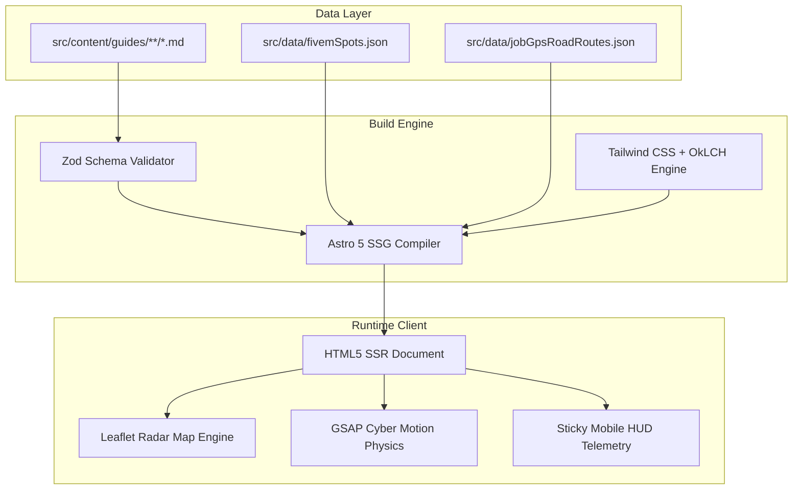

# 🏛️ ARCH-01: Full Stack Architecture Audit & Technical Debt

This document provides a comprehensive technical audit of the **RUN TOWN Wiki & Radar Map Portal**, analyzing predecessor code, component hierarchies, runtime characteristics, and identified technical debt.

---

## 1. Macro Architectural Topology

The system is architected as an **Edge-Precomputed Jamstack Hybrid** combining Astro SSG for instantaneous content delivery and client-side GSAP + Leaflet for high-framerate interactive spatial mechanics.

---

## 2. Component Hierarchy & Data Flow

- **Root Layout:** `src/layouts/BaseLayout.astro`
  - Global styles (`src/styles/global.css`), cyber motion bindings (`src/scripts/cyberMotion.ts`), and meta tags.
- **Guide Layout:** `src/layouts/GuideLayout.astro`
  - Dynamic Table of Contents (`TableOfContents.astro`), Breadcrumbs, Sticky Telemetry HUD (`GuideStickyHUD.astro`), and Image Lightbox (`ImageLightboxModal.astro`).
- **Interactive Calculators:**
  - `ProfitCalculator.astro`: Dynamic profit margin simulator for agriculture and manufacturing.
  - `SportTuningCalculator.astro`: Vehicle gear ratio, acceleration, and top-speed telemetry engine.
  - `CraftingTree.astro`: Hierarchical dependency tree for weapon and item crafting.
  - `BrainFatigueMeter.astro` & `FoodHungerMeter.astro`: Real-time survival status simulators.

---

## 3. Spatial Radar Map Architecture (`src/pages/map.astro`)

- **SSOT Spot Data (`src/data/mapSpots.ts`):** Consolidates 47 canonical map spots (`SPOTS`) with 54 backward-compatible `SPOT_ALIASES` and verified `getSpotExtraInfo()` metadata, replacing inline duplication in `map.astro`.
- **SSOT Economy Formulas (`src/data/economy.ts`):** Centralizes Trading Buffer rules (`30 - 10 = 20 kg`), brain/hunger rates, vehicle tiers, and all 8 White Jobs (`WHITE_JOBS`).
- **Raster Projection:** Leaflet CRS.Simple mapped onto GTA V in-game world coordinates (`X: [-4140, 4860]`, `Y: [-5100, 8400]`).
- **Road Route Solver:** Uses pre-calculated waypoint graphs from `src/data/jobGpsRoadRoutes.json` avoiding heavy runtime Dijkstra/A* computations in the browser.
- **ViewTransitions Lifecycle:** Cleans up Leaflet instances (`mapInstance.remove()`) and event listeners via `AbortController` on `astro:before-swap`.

---

## 4. Technical Debt & Optimization Vectors

1. **Image & Asset Weight:** `hero-city.png` was converted to `.webp` (`185 KB`) and `public/maps/spots/*.png` compressed by ~10 MB (`~22.2 MB -> ~12.1 MB`).
2. **Legacy Historical Docs:** `FEAT_01`, `FEAT_02`, and `FEAT_04` carry historical snapshot notices pointing agents to [[runtown-economy]] and `src/data/economy.ts`.
3. **Regression Guardrails:** `npm run check`, `npm run build`, and `npm test` (`tests/integrity.test.mjs`) enforce SSOT consistency, link integrity, reduced-motion CSS, Cloudflare deployment configs (`wrangler.jsonc`, `dist/_headers`, `dist/404.html`), and traversal guards.
4. **Edge Deployment:** Configured for **Cloudflare Workers Static Assets** via `wrangler.jsonc` (`assets.directory = "./dist"`, `not_found_handling = "404-page"`) and `public/_headers` (security headers + `/_astro/*` immutable caching), replacing legacy Surge/Vercel files.
