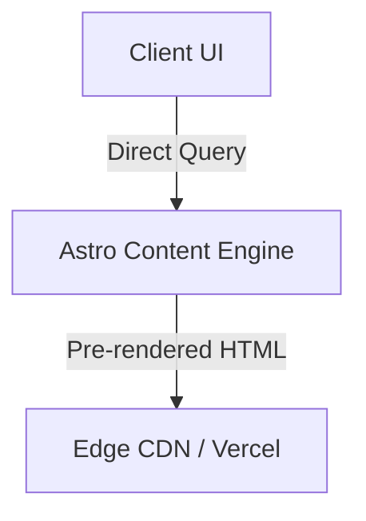

# 🏛️ ADR-<% tp.file.title.match(/\d+/) ? tp.file.title.match(/\d+/)[0] : "XX" %>: <% tp.file.title.replace(/^ARCH_\d+_?/, '') %>

> **Status:** Accepted / Proposed / Deprecated  
> **Deciders:** Core Engineering Team & AI Lead Architect  
> **Date:** <% tp.date.now("YYYY-MM-DD") %>

---

## 1. Context & Problem Statement
Explain the context, requirements, technical debt, or user constraints leading to this architectural choice.

## 2. Considered Options
- **Option 1:** [Description of option 1]
- **Option 2:** [Description of option 2]
- **Option 3:** [Description of option 3]

## 3. Decision Outcome
Chosen option: **Option X**, because:
1. Reason 1
2. Reason 2
3. Reason 3

## 4. Consequences & Trade-offs
- **Positive Consequences:**
  - Improved latency / developer velocity / build stability
- **Negative Consequences / Risks:**
  - Additional maintenance / migration overhead

## 5. Architectural Diagram

