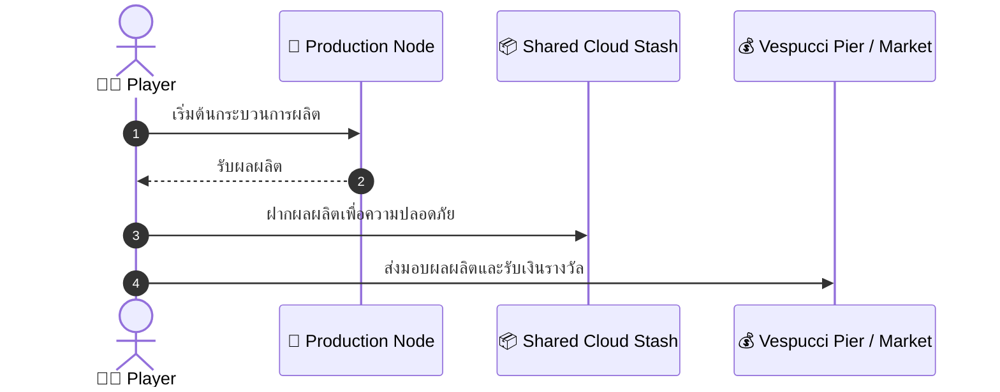

# 🚀 <% tp.file.title %>

> **Executive Summary:** Brief 1-2 sentence overview of this feature or career guide.

---

## 📑 สารบัญ (Table of Contents)
1. [[#1. ภาพรวม & กลไกหลัก (System Overview)]]
2. [[#2. สเปกยานพาหนะ & ข้อจำกัดความจุ (Logistics)]]
3. [[#3. แผนผังลำดับขั้นตอน (Sequence Flow)]]
4. [[#4. จุดคุ้มทุน & การวิเคราะห์กำไร (Economics)]]
5. [[#5. ข้อควรระวัง & กฎความปลอดภัย (Anti-Grief / Safe Zone)]]

---

## 1. ภาพรวม & กลไกหลัก (System Overview)
คำอธิบายกลไกการทำงาน แหล่งวัตถุดิบ จุดเริ่มต้น และอัตราการได้ผลผลิตต่อรอบ

## 2. สเปกยานพาหนะ & ข้อจำกัดความจุ (Logistics)
| คลาสรถ | ความจุ (กก.) | ผลผลิตสูงสุด/เที่ยว | รายได้สุทธิ/เที่ยว |
| :--- | :---: | :---: | :---: |
| City Car | 60 กก. | - | - |
| Sedan / SUV | 120 กก. | - | - |
| Truck / Pickup | 150 กก. | - | - |

## 3. แผนผังลำดับขั้นตอน (Sequence Flow)

## 4. จุดคุ้มทุน & การวิเคราะห์กำไร (Economics)
- **ต้นทุนเงินสด:**
- **ผลตอบแทนต่อชั่วโมง:**
- **จุดคุ้มทุน (Break-even):**

## 5. ข้อควรระวัง & กฎความปลอดภัย (Anti-Grief / Safe Zone)
- [ ] ไม่อยู่ในเขต Red Zone โดยไม่มีการคุ้มกัน
- [ ] ตรวจสอบระดับอาหารและน้ำ (ไม่ต่ำกว่า 20%)
- [ ] ตรวจสอบค่าความล้าสมอง (ไม่เกิน 400 action)
