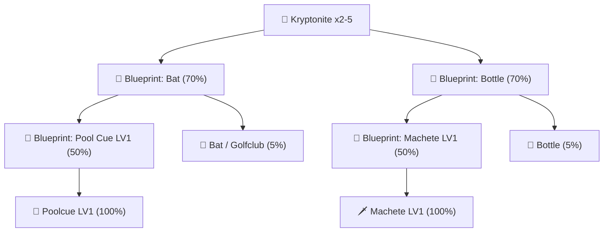

## ⚙️ แกนคอร์หลักสำหรับขึ้นรูปอาวุธ (Cores)

ในการคราฟต์อาวุธทุกประเภท ผู้เล่นจำเป็นต้องมี **Core** เฉพาะทางตามประเภทของการโจมตี:

---

### 1. 💥 Impact Core (แกนกระแทก — การันตีสายไม้)
* **การใช้งาน:** ใช้สำหรับขึ้นรูปและ **การันตีสายทุบ/ไม้** เช่น ไม้เบสบอล (Bat), ไม้กอล์ฟ (Golfclub), ไม้พูล (Poolcue Lv.1), สนับมือ (Knuckle Lv.1)
* **โอกาสสำเร็จ:** **100%** (มีโอกาสพิเศษ **3%** ได้รับโบนัสเบิ้ลเป็น x2 ชิ้น)
* **วัตถุดิบที่ใช้:**
  * 📦 Weapon Box Set x 1

  

---

### 2. 🩸 Edge Core (แกนคมมีด — การันตีสายมีด)
* **การใช้งาน:** ใช้สำหรับขึ้นรูปและ **การันตีสายคม/มีด** เช่น มีดพก (Knife Lv.1), มีดพร้า (Machete Lv.1), แดกเกอร์ (Dagger Lv.1), ขวดแตก (Bottle)
* **โอกาสสำเร็จ:** **100%** (มีโอกาสพิเศษ **3%** ได้รับโบนัสเบิ้ลเป็น x2 ชิ้น)
* **วัตถุดิบที่ใช้:**
  * 📦 Weapon Box Set x 1

  

---

## 📦 วัตถุดิบแกนกลาง & แร่หายาก

### 3. 📦 Weapon Box Set (กล่องตีอาวุธ)
* **การใช้งาน:** แกนกลางในการนำไปแปลงเป็น Impact Core หรือ Edge Core
* **โอกาสสำเร็จ:** **100%**

#### 📋 วัตถุดิบแยกชิ้นสำหรับคราฟต์ Weapon Box Set:

| ไอคอน | วัตถุดิบ (Ingredient) | จำนวนที่ต้องใช้ | รายละเอียด |
| :---: | :--- | :---: | :--- |
|  | **Cement (ปูน)** | **x2** | ถุงปูนผสมงานช่าง |
|  | **Wood Crate (ลังไม้)** | **x10** | ลังไม้แพ็คจากโรงเลื่อย |
|  | **Gold Ingot (ทองคำแท่ง)** | **x5** | ทองคำแท่งหลอมบริสุทธิ์ |
|  | **Steel Ingot (เหล็กกล้าแท่ง)** | **x20** | เหล็กกล้าแท่งหลอม |
|  | **Money (เงินเขียว)** | **$10,000** | ค่าธรรมเนียมช่างตีกล่อง |

  

---

### 4. 💎 Kryptonite (แร่คริปโตไนท์)
* **การใช้งาน:** สารเร่งสำคัญในการวิจัยและหลอมพิมพ์เขียว (Blueprint) อาวุธ
* **โอกาสสำเร็จ:** **70%**

#### 📋 วัตถุดิบแยกชิ้นสำหรับคราฟต์ Kryptonite:

| ไอคอน | วัตถุดิบ (Ingredient) | จำนวนที่ต้องใช้ | รายละเอียด |
| :---: | :--- | :---: | :--- |
|  | **Cement (ปูน)** | **x10** | ถุงปูนผสมงานช่าง |
|  | **Copper Ingot (ทองแดงแท่ง)** | **x15** | ทองแดงแท่งหลอม |
|  | **Steel Ingot (เหล็กกล้าแท่ง)** | **x20** | เหล็กกล้าแท่งหลอม |
|  | **Cut Diamond (เพชรเจีย)** | **x1** | เพชรเจียระไนบริสุทธิ์ |
|  | **Money (เงินเขียว)** | **$5,000** | ค่าธรรมเนียมเตาหลอม |

  

---

### 5. 🔐 Vault Key (กุญแจตู้เซฟ)
* **การใช้งาน:** สำหรับเปิดตู้เซฟนิรภัยเก็บของมีค่าและอาวุธ
* **โอกาสสำเร็จ:** **100%**

#### 📋 วัตถุดิบแยกชิ้นสำหรับคราฟต์ Vault Key:

| ไอคอน | วัตถุดิบ (Ingredient) | จำนวนที่ต้องใช้ | รายละเอียด |
| :---: | :--- | :---: | :--- |
|  | **Copper Ingot (ทองแดงแท่ง)** | **x10** | ทองแดงแท่งหลอม |
|  | **Gold Ingot (ทองคำแท่ง)** | **x4** | ทองคำแท่งหลอมบริสุทธิ์ |
|  | **Money (เงินเขียว)** | **$20,000** | ค่าธรรมเนียมช่างทำกุญแจ |

  

---

## 📜 ผังการคราฟต์พิมพ์เขียว (Blueprint Crafting Tree)

---

## 📜 พิมพ์เขียวตั้งต้น Tier 1 (Blueprint: Bat & Blueprint: Bottle)

### 1. 📜 Blueprint: Bat (อัตราสำเร็จ 70%)
* **การใช้งาน:** พิมพ์เขียวพื้นฐานสำหรับคราฟต์ **Bat (ไม้เบสบอล)**, **Golfclub (ไม้กอล์ฟ)** และเป็นวัตถุดิบทำ **Blueprint: Pool Cue LV1**
* **โอกาสสำเร็จ:** **70%**

  

| ไอคอน | วัตถุดิบ (Ingredient) | จำนวน |
| :---: | :--- | :---: |
|  | **Kryptonite** | **x2** |
|  | **Cut Diamond** | **x5** |
|  | **Gold Ingot** | **x10** |
|  | **Wood Crate** | **x10** |
|  | **Steel Ingot** | **x20** |
|  | **Money (เงินเขียว)** | **$20,000** |

---

### 2. 📜 Blueprint: Bottle (อัตราสำเร็จ 70%)
* **การใช้งาน:** พิมพ์เขียวพื้นฐานสำหรับคราฟต์ **Bottle (ขวดแตก)** และเป็นวัตถุดิบทำ **Blueprint: Machete LV1**
* **โอกาสสำเร็จ:** **70%**

  

| ไอคอน | วัตถุดิบ (Ingredient) | จำนวน |
| :---: | :--- | :---: |
|  | **Kryptonite** | **x2** |
|  | **Cut Diamond** | **x5** |
|  | **Gold Ingot** | **x10** |
|  | **Wood Crate** | **x10** |
|  | **Steel Ingot** | **x20** |
|  | **Money (เงินเขียว)** | **$20,000** |

---

## 🔍 สูตรคราฟต์พิมพ์เขียวขั้นสูง Tier 2 (โอกาสสำเร็จ 50%)

พิมพ์เขียว Tier 2 แบ่งออกเป็น 2 สายหลักตามพิมพ์เขียวตั้งต้น:

---

### 1. 🎱 Blueprint: Pool Cue LV1 (สายไม้)
* **ฐานพิมพ์เขียวที่ต้องใช้:** 📜 **Blueprint: Bat x1**
* **โอกาสสำเร็จ:** **50%**

  

| ไอคอน | ชื่อไอเทม (Item Name) | จำนวนที่ต้องใช้ | รายละเอียด / ที่มา |
| :---: | :--- | :---: | :--- |
|  | **Blueprint: Bat** | **x1** | พิมพ์เขียวฐานสายไม้ (Tier 1) |
|  | **Kryptonite** | **x5** | แร่สังเคราะห์พิเศษ (สำเร็จ 70%) |
|  | **Cut Diamond** | **x10** | เพชรเจียระไนจากการขุด/ล้างแร่ |
|  | **Gold Ingot** | **x10** | ทองคำแท่งหลอมบริสุทธิ์ |
|  | **Wood Crate** | **x10** | ลังไม้แพ็คจากโรงเลื่อย |
|  | **Steel Ingot** | **x20** | เหล็กกล้าแท่งหลอม |
|  | **Crystal Ingot** | **x25** | แร่คริสตัลแท่งจากจุดฟาร์มลึก |
|  | **Black Money (เงินดำ)** | **$20,000** | ค่าธรรมเนียมเงินดำใต้ดิน |

---

### 2. 🥊 Blueprint: Knuckle LV1 (สายสนับมือ)
* **ฐานพิมพ์เขียวที่ต้องใช้:** 📜 **Blueprint: Bat x1**
* **โอกาสสำเร็จ:** **50%**

  

| ไอคอน | ชื่อไอเทม (Item Name) | จำนวนที่ต้องใช้ | รายละเอียด / ที่มา |
| :---: | :--- | :---: | :--- |
|  | **Blueprint: Bat** | **x1** | พิมพ์เขียวฐานสายไม้ (Tier 1) |
|  | **Kryptonite** | **x5** | แร่สังเคราะห์พิเศษ (สำเร็จ 70%) |
|  | **Cut Diamond** | **x10** | เพชรเจียระไนจากการขุด/ล้างแร่ |
|  | **Gold Ingot** | **x10** | ทองคำแท่งหลอมบริสุทธิ์ |
|  | **Wood Crate** | **x10** | ลังไม้แพ็คจากโรงเลื่อย |
|  | **Steel Ingot** | **x20** | เหล็กกล้าแท่งหลอม |
|  | **Crystal Ingot** | **x25** | แร่คริสตัลแท่งจากจุดฟาร์มลึก |
|  | **Black Money (เงินดำ)** | **$20,000** | ค่าธรรมเนียมเงินดำใต้ดิน |

---

### 3. 🔪 Blueprint: Knife LV1 (สายมีดพก)
* **ฐานพิมพ์เขียวที่ต้องใช้:** 📜 **Blueprint: Bottle x1**
* **โอกาสสำเร็จ:** **50%**

  

| ไอคอน | ชื่อไอเทม (Item Name) | จำนวนที่ต้องใช้ | รายละเอียด / ที่มา |
| :---: | :--- | :---: | :--- |
|  | **Blueprint: Bottle** | **x1** | พิมพ์เขียวฐานสายมีด/ขวด (Tier 1) |
|  | **Kryptonite** | **x5** | แร่สังเคราะห์พิเศษ (สำเร็จ 70%) |
|  | **Cut Diamond** | **x10** | เพชรเจียระไนจากการขุด/ล้างแร่ |
|  | **Gold Ingot** | **x10** | ทองคำแท่งหลอมบริสุทธิ์ |
|  | **Wood Crate** | **x10** | ลังไม้แพ็คจากโรงเลื่อย |
|  | **Steel Ingot** | **x20** | เหล็กกล้าแท่งหลอม |
|  | **Crystal Ingot** | **x25** | แร่คริสตัลแท่งจากจุดฟาร์มลึก |
|  | **Black Money (เงินดำ)** | **$20,000** | ค่าธรรมเนียมเงินดำใต้ดิน |

---

### 4. 🗡️ Blueprint: Machete LV1 (สายมีดพร้าแรงสุด)
* **ฐานพิมพ์เขียวที่ต้องใช้:** 📜 **Blueprint: Bottle x1**
* **โอกาสสำเร็จ:** **50%**

  

| ไอคอน | ชื่อไอเทม (Item Name) | จำนวนที่ต้องใช้ | รายละเอียด / ที่มา |
| :---: | :--- | :---: | :--- |
|  | **Blueprint: Bottle** | **x1** | พิมพ์เขียวฐานสายมีด/ขวด (Tier 1) |
|  | **Kryptonite** | **x5** | แร่สังเคราะห์พิเศษ (สำเร็จ 70%) |
|  | **Cut Diamond** | **x10** | เพชรเจียระไนจากการขุด/ล้างแร่ |
|  | **Gold Ingot** | **x10** | ทองคำแท่งหลอมบริสุทธิ์ |
|  | **Wood Crate** | **x10** | ลังไม้แพ็คจากโรงเลื่อย |
|  | **Steel Ingot** | **x20** | เหล็กกล้าแท่งหลอม |
|  | **Crystal Ingot** | **x25** | แร่คริสตัลแท่งจากจุดฟาร์มลึก |
|  | **Black Money (เงินดำ)** | **$20,000** | ค่าธรรมเนียมเงินดำใต้ดิน |

