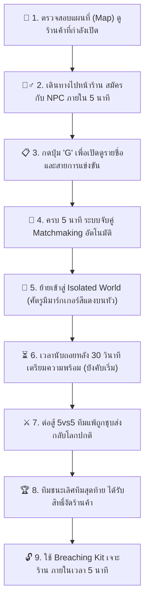

  

    

      

        
      

      
        5vs5 GvG
      
    

    

      

        🏪
        สมรภูมิงัดร้านค้า (STORE ROBBERY TOURNAMENT)
      

      <h2 class="text-2xl sm:text-3xl font-display font-extrabold text-white tracking-wide">
        สงครามแย่งชิงร้านค้า 5vs5 มิติแยก (Isolated World)
      </h2>
      

        กิจกรรมปะทะระหว่างแก๊งแบบ Bracket Tournament ในมิติแยกส่วนตัว ชิงสิทธิ์งัดตู้เซฟร้านค้าด้วย <strong>Breaching Kit</strong> ทีมที่เหลือรอดเป็นทีมสุดท้ายรับของรางวัลระดับสูง Diamond Ingot, Dirty Money และ Lucky Box
      

    

  

---

## ⏱️ ข้อมูล & ตารางเวลาการเปิดร้านค้า (Schedule & Rules)

การปล้นร้านค้าในเมือง RUN TOWN เป็นระบบทัวร์นาเมนต์ที่ปลอดภัยจากการรบกวนภายนอก โดยมีกฎและเงื่อนไขเวลาดังนี้:

| หัวข้อกำหนด | รายละเอียดระบบ | คำแนะนำ & ข้อควรระวัง |
| :--- | :--- | :--- |
| **จำนวนผู้เล่น** | **5 vs 5 คน** (ระบบทีม) | ผู้เข้าแข่งขันทุกคน**ต้องมีรายชื่อใน [Headquarter (HQ)](/guides/gang/headquarter)** |
| **จำนวนร้านค้าที่เปิด** | **3 ร้าน** (ช่วงทดสอบระบบ Beta) | ติดตามสถานะร้านค้าและไอคอนร้านได้โดยตรงจาก **หน้าแผนที่ (Map)** |
| **ช่วงเวลาเปิดทำการ** | **12:00 น. ถึง 03:00 น.** (เวลาประเทศไทย) | ร้านจะไม่เปิดในช่วงเช้าตรู่ (03:01 - 11:59) |
| **รอบแรกหลังเปิดเซิร์ฟ** | **สุ่มเกิด 30 - 50 นาที** หลังเซิร์ฟเวอร์เปิด | ให้สมาชิกแก๊งสแตนด์บายเตรียมอาวุธและ Breaching Kit ให้พร้อม |
| **คูลดาวน์หลังจบการแข่งขัน** | **40 นาที** (นับจากร้านก่อนหน้าจบลง) | เมื่อหมดคูลดาวน์ระบบจะสุ่มเปิดร้านค้ารอบถัดไป |
| **มิติพื้นที่ (World Instance)** | **แยก World อิสระ** | ผู้เล่นภายนอกไม่สามารถมองเห็นหรือเข้ามายิงแทรกแซงได้ |
| **ระบบหลังพ่ายแพ้** | **ชุบชีวิตอัตโนมัติ** | ทีมที่สลบจะได้รับการชุบชีวิตฟื้นฟู และวาร์ปส่งกลับมายังมิติปกติทันที |

---

## 🎮 ขั้นตอนการเข้าร่วม & กฎการแข่งขัน (Step-by-Step Flow)

### 1. การสมัครเข้าร่วม (Registration Phase)
* สมาชิกทีม 5 คน เดินทางไปยังหน้าร้านค้าที่ขึ้นแจ้งเตือนบนแผนที่
* กดคุยเพื่อสมัครเข้าร่วมกับ **NPC ประจำหน้าร้าน**
* มีเวลาเปิดรับสมัครเพียง **5 นาที** เท่านั้น หากหมดเวลาจะไม่สามารถลงทะเบียนเพิ่มได้
* สามารถกดคีย์ลัด **`G`** เพื่อเปิดดูรายชื่อทีมทั้งหมด และตรวจสอบสายการแข่งขัน (Tournament Bracket)

### 2. การจับคู่และการต่อสู้ (Matchmaking & Battle Phase)
* เมื่อสิ้นสุดเวลา 5 นาที ระบบจะสุ่มประกบคู่ต่อสู้โดยอัตโนมัติ
* ตัวละครจะถูกดึงเข้าสู่ **มิติแยก (Isolated World)**
* **จุดสังเกตศัตรู:** ฝ่ายตรงข้ามจะมี **Marker สัญลักษณ์สีแดง** ปรากฏอยู่บนศีรษะอย่างชัดเจน
* มีเวลาเตรียมตัว **30 วินาที** ก่อนเปิดฉากยิง หากหมดเวลาระบบจะบังคับเริ่มทันทีโดยไม่มีการรอ
* ทีมที่สมาชิกสลบจนหมดทั้งทีม ระบบจะทำการ **ชุบชีวิตอัตโนมัติ** แล้วเทเลพอร์ตปรับส่งกลับสู่โลกปกติ (Normal World) อย่างปลอดภัย

### 3. การงัดร้านค้าของผู้ชนะ (Breaching Phase)
* ทีมที่ยืนหยัดเป็นทีมสุดท้ายและคว้าชัยชนะในรอบชิงชนะเลิศ จะได้รับสิทธิ์ในการงัดร้านค้า
* **เงื่อนไขสำคัญ:** ต้องพกพาไอเทม **Breaching Kit (ชุดอุปกรณ์งัดแงะ)** มาด้วย
* **จำกัดเวลา:** ต้องทำการงัดร้านให้เสร็จสิ้นภายใน **5 นาที** หลังจากจบการต่อสู้รอบสุดท้าย

---

## 🛠️ สูตรคราฟต์ไอเทม Breaching Kit (100% Success)

ไอเทมจำเป็นสำหรับการปลดล็อครางวัลของทีมชนะเลิศ สามารถคราฟต์ได้ที่โต๊ะช่าง:

  

### 📋 วัตถุดิบที่ใช้ในการผลิต Breaching Kit:

| ไอคอน | ชื่อไอเทม / วัตถุดิบ | จำนวนที่ใช้ | ระดับ & คุณสมบัติ |
| :---: | :--- | :---: | :--- |
|  | **Breaching Kit** *(ผลลัพธ์)* | **1 ชิ้น** | **ระดับทั่วไป (General)** · อัตราสำเร็จ **100%** · เวลาคราฟต์ 10 วินาที |
|  | **Black Money (เงินแดง)** | **1,500 บาท** | เงินนอกกฎหมายที่ได้จากการฟาร์มงานดำหรือกิจกรรมใต้ดิน |
|  | **Copper Ingot (ทองแดงแท่ง)** | **10 ชิ้น** | แท่งทองแดงหลอมเกรดอุตสาหกรรมสำหรับทำหัวเจาะ |

> [!TIP]
> **ข้อแนะนำก่อนลงแข่ง:** ควรให้สมาชิกในทีมอย่างน้อย 2 คนพก **Breaching Kit** สำรองไว้ในกระเป๋า เพื่อป้องกันเหตุฉุกเฉินกรณีผู้ถือไอเทมหลุดหรือเกิดความผิดพลาดในการงัด

---

## 🎁 รายการของรางวัลสำหรับทีมชนะเลิศ (Winner Loot Pool)

เมื่อทีมชนะเลิศใช้งาน Breaching Kit งัดร้านค้าสำเร็จ จะได้รับไอเทมของรางวัลเข้ากระเป๋าดังนี้:

| ไอคอนของรางวัล | ชื่อไอเทม | จำนวนที่ได้รับ | มูลค่า & การนำไปใช้งาน |
| :---: | :--- | :---: | :--- |
|  | **Diamond Ingot** | **2 - 3 ชิ้น** | แร่ระดับแรร์พิเศษ สำหรับคราฟต์อาวุธขั้นสูงและอุปกรณ์ระดับท็อป |
|  | **Dirty Money (เงินแดง)** | **12,000 - 18,000 บาท** | เงินหมุนเวียนแก๊งสำหรับซื้อเสบียง อาวุธ และใช้คราฟต์ HQ Coin |
|  | **AED (เครื่องกระตุกหัวใจพกพา)** | **8 - 10 เครื่อง** | อุปกรณ์ชุบชีวิตเพื่อนร่วมทีมในสนามรบ ปัจจัยสำคัญสำหรับไฟต์ใหญ่ |
|  | **Bandage (ผ้าพันแผล)** | **20 - 30 ชิ้น** | เวชภัณฑ์ฟื้นฟูเลือดพื้นฐาน เพิ่มความต่อเนื่องในการรบ |
|  | **Lucky Box** | **1 กล่อง** | กล่องสุ่มรางวัลล้ำค่า ลุ้นรับพิมพ์เขียวอาวุธและไอเทมสุดพิเศษ |

---

## 📡 การสื่อสาร & กลยุทธ์ในการแข่ง 5vs5

1. **การใช้วิทยุสื่อสาร [Radio (กด O)](/guides/gang/radio):**
   * ทีมงานและแก๊งที่มีชื่อในระบบ **Run Headquarter** สามารถใช้วิทยุสื่อสารช่องเฉพาะเพื่อบอกตำแหน่งและคอลเป้าหมาย
2. **การสังเกตศัตรูด้วย Marker สีแดง:**
   * ในช่วง 30 วินาทีแรก เช็คตำแหน่งการกระจายตัวของฝั่งตรงข้ามผ่านมาร์กเกอร์สีแดงเหนือหัว เพื่อวางแผนประกบยิง
3. **การบริหารสิทธิ์สมาชิกแก๊ง:**
   * ระบบ Store Robbery อ้างอิงจากรายชื่อสมาชิกใน **Run Headquarter** เท่านั้น หัวหน้าแก๊งควรตรวจสอบว่าผู้เล่นทั้ง 5 คนได้รับการลงทะเบียนเรียบร้อยแล้วผ่านเมนู `F10 > Member`

---

## 🔗 ลิงก์คู่มือที่เกี่ยวข้อง
* 👑 **[ระบบแก๊ง Headquarter & เหรียญ HQ Coin](/guides/gang/headquarter)** - คู่มือการขึ้นทะเบียนแก๊งและระบบคลัง Supplies
* 📻 **[วิทยุสื่อสาร Radio (กด O)](/guides/gang/radio)** - สิทธิ์การใช้วอและการตั้งคลื่นความถี่แก๊ง
* 🗺️ **[แผนที่จุดสำคัญ & จุดตรวจเมือง](/map)** - แผนที่แบบ Interactive สำหรับติดตามจุดเกิดร้านค้า
